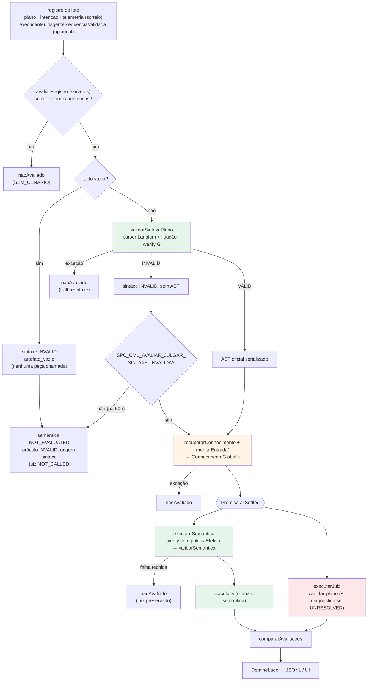
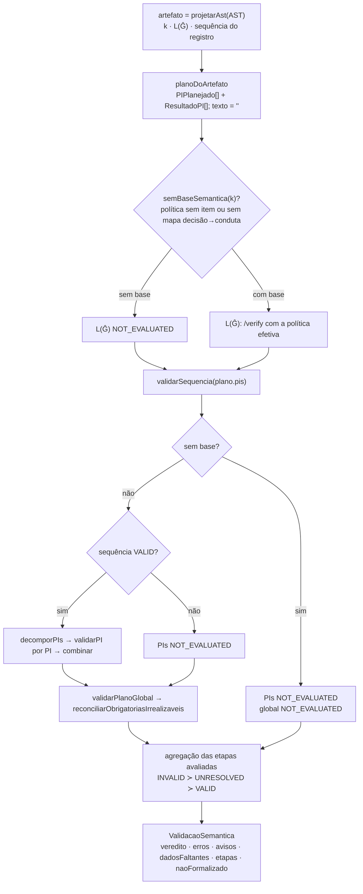

# Auditoria do Oráculo do SPC-CML

Relatório técnico da inspeção do Oráculo de validação de planos: o que o código faz, com que evidência, e onde o comportamento diverge da arquitetura descrita. Para a explicação conceitual do Oráculo, ver [oraculo.md](oraculo.md). Este documento é o registro da auditoria e não substitui aquele.

| | |
|---|---|
| Data | 2026-10-13 |
| Base inspecionada | branch `dev-gem`, `HEAD` `a264616`, **com as alterações em stage ainda não commitadas** (entre elas `avaliar-grafo.ts`, `server.ts`, `diagnostico-juiz.ts`, `motor-http.ts`) |
| Código alterado nesta tarefa | nenhum. Só foram criados este relatório e [oraculo.md](oraculo.md), e acrescentado um link no [README raiz](../README.md) |
| Ambiente das execuções | Windows 11, Node 24.21, Neo4j em `bolt://localhost:7687`, motores Python em 8000/8001/8002 (Qwen2.5-7B Q4_K_M + bge-m3), API em 4000, `SPC_CML_RECUPERACAO` não definido (modo determinístico) |

---

## Sumário

0. [Método e classificação da evidência](#0-método-e-classificação-da-evidência)
1. [Resumo executivo](#1-resumo-executivo)
2. [Arquitetura real](#2-arquitetura-real)
3. [Inventário de validadores](#3-inventário-de-validadores)
4. [Fichas por validação](#4-fichas-por-validação)
5. [Contratos de resultado](#5-contratos-de-resultado)
6. [Determinismo e limites formais](#6-determinismo-e-limites-formais)
7. [Lacunas e divergências](#7-lacunas-e-divergências)
8. [Testes e execuções desta auditoria](#8-testes-e-execuções-desta-auditoria)
9. [Anexo A — script da demonstração no domínio `fut`](#9-anexo-a--script-da-demonstração-no-domínio-fut)

---

## 0. Método e classificação da evidência

1. Leitura integral de [avaliar-grafo.ts](../src/inference/avaliar-grafo.ts) e [avaliar-sintaxe.ts](../src/inference/avaliar-sintaxe.ts), que compõem o Oráculo, e dos módulos que eles chamam: [validacao.ts](../src/knowledge/validacao.ts), [validacao-sequencia.ts](../src/knowledge/validacao-sequencia.ts), [validacao-pi.ts](../src/knowledge/validacao-pi.ts), [validacao-global.ts](../src/knowledge/validacao-global.ts), [contrato.ts](../src/knowledge/contrato.ts), [contrato-pi.ts](../src/knowledge/contrato-pi.ts), [decompositor.ts](../src/knowledge/decompositor.ts), [recuperacao-conhecimento.ts](../src/inference/recuperacao-conhecimento.ts), [graphrag-fut.ts](../src/knowledge/graphrag-fut.ts), [fut-client.ts](../src/inference/fut-client.ts), da rota `/verify` em [main.py](../src/python_engine/main.py), do juiz em [julgamento.py](../src/python_engine/julgamento.py) e da orquestração em [server.ts](../src/web/server.ts) (`avaliarRegistro`, `avaliarComGrafo`).
2. Leitura do modelo [futebol.fut](../src/examples/fut/futebol.fut), da gramática [futebol.langium](../src/language/futebol.langium) e da BNF gerada [futebol.bnf](../src/python_engine/grammar/futebol.bnf).
3. Leitura dos testes, usados para corroborar o código, nunca como evidência isolada.
4. Execução das suítes pertinentes (§8) e de um script que chama o **mesmo** `avaliarPlano` de `POST /api/avaliar` contra Neo4j e `/verify` reais, no domínio `fut` (§8.2, Anexo A).

Cada conclusão importante recebe uma das classes abaixo:

| Marca | Classe | Critério |
|---|---|---|
| **[IC]** | Implementado e confirmado | encontrado no código **e** corroborado por teste ou por execução registrada aqui |
| **[IS]** | Implementado, sem comprovação suficiente | existe no código, sem teste ou execução que o exercite |
| **[P]** | Parcial | só parte do comportamento esperado existe |
| **[NF]** | Não formalizado | existe como texto, descrição ou atributo declarado, sem critério computacional |
| **[NI]** | Não implementado | nada encontrado após a inspeção |
| **[D]** | Divergência | documentação, teste e implementação discordam |

Testes que passam não são prova matemática. Onde este relatório diz "confirmado", quer dizer: o código faz isso e uma execução observada o mostrou.

---

## 1. Resumo executivo

**O que o Oráculo é no código.** É a parte determinística da avaliação de planos **já gerados** (`POST /api/avaliar`). Em sentido estrito, é a função [`oraculoDe`](../src/inference/avaliar-grafo.ts#L616): se a sintaxe é INVALID, o veredito é INVALID; caso contrário, vale o veredito da semântica. Em sentido amplo, e é assim que o README e este relatório o tratam, é a cascata inteira que produz esse veredito:

1. **sintaxe**: o texto pertence à DSL? Duas peças precisam aceitar: a gramática G pelo `/verify` sem política, e o parser Langium com ligação de referências;
2. **AST**: o AST oficial do Langium, serializado. É o único objeto que a semântica lê;
3. **recuperação**: o conhecimento do cenário é refeito a partir do registro, pela mesma função usada na geração;
4. **semântica**: os validadores da geração multiagente, na ordem dela: L(Ĝ), `validarSequencia`, `decomporPIs` + `validarPI` e `validarPlanoGlobal`;
5. **agregação**: INVALID prevalece sobre UNRESOLVED, que prevalece sobre VALID.

**Problema que resolve.** O plano vem de um LLM e não é reprodutível como texto. O Oráculo não tenta reproduzir o raciocínio do modelo. Julga o **artefato**, contra as regras formalizadas na DSL e o conhecimento recuperado para o cenário, e devolve um de três vereditos com códigos e evidências.

**Garantias observadas:**

- A aplicação dos critérios é feita por funções sem LLM e sem aleatoriedade. Com as mesmas entradas, o resultado lógico se repete. Isso foi observado em execuções repetidas, inclusive em processos diferentes (§8.2) **[IC]**.
- UNRESOLVED não vira INVALID, e o juiz LLM não altera o Oráculo (`compararAvaliacoes`; testes "caso 4 / teste D" e "as nove combinacoes") **[IC]**.
- Violação comprovada prevalece sobre lacuna, tanto na agregação quanto dentro de cada validador **[IC]**.
- Falha técnica (motor, grafo, parser, defeito interno) não produz veredito normativo: a linha fica `naoAvaliado` **[IC]**.
- A semântica lê o AST, não o texto. Reformatar o texto não muda o veredito **[IC]**.

**Limitações principais** (detalhes em §7):

- O conhecimento contra o qual o plano é julgado **inclui o foco por embedding** (Neo4j + bge-m3). Com o foco disponível ou indisponível, o **mesmo plano** recebeu vereditos **diferentes** no domínio `fut` (§7, L1). O determinismo vale **dado o estado do conhecimento**, não independentemente dele.
- No modo determinístico, que é o padrão, medida ausente faz a regra **não incidir**. Isso não gera UNRESOLVED. No modelo `fut` atual, `telemetria_insuficiente` não é alcançável nem no modo híbrido (L4).
- Vários atributos do modelo `fut` são apenas declarados: `sancao`, `zona_penal`, `reinicios` por infração, `isento`, `regra_global` e `requer_var`. Um plano com `CARTAO_VERMELHO` para `Impedimento` saiu **VALID** (L5).
- A métrica `violacao` só reconhece decisões do domínio `med` (L6).
- Os testes do avaliador cobrem só `med`, com G conferida pelo reconhecedor Earley em vez do `/verify`, e sempre com o foco indisponível (L9).

---

## 2. Arquitetura real

### 2.1 Cascata de uma linha (`avaliarPlano`)



Verde: determinístico. Laranja: contém uma etapa aproximada, o foco por embedding (§6). Vermelho: LLM, fora do Oráculo.

### 2.2 Etapas da semântica (`validarSemantica`)



### 2.3 Geração × avaliação

Os validadores são os mesmos da geração multiagente, mas o fluxo da avaliação não é o da geração. As diferenças estão no código:

| Aspecto | Geração (`decodificarMultiagente`) | Avaliação (`avaliarPlano`) | Evidência |
|---|---|---|---|
| Entrada da semântica | texto composto, relido por `lerArtefato` | AST do parser, por `projetarAst`; `texto` vazio | `planoDoArtefato`; teste "isolamento" **[IC]** |
| Pedido sem item citado | encerra **antes** do Planner (`alvoDoPedido`) | não há pré-checagem; `validarPlanoGlobal` devolve UNRESOLVED `pedido_global_indeterminado` | §8.2 caso "pedido sem o nome" **[IC]** |
| Lacunas do conhecimento | `lacunasDoConhecimento` encerra antes do Planner | etapas rodam; `escalonamento_ignorado` irrealizável é reclassificado como lacuna | `reconciliarObrigatoriasIrrealizaveis`; teste "regra que obriga..." **[IC]** |
| Retry, repoda, feedback | sim (Planner, PI, ciclo global) | não: uma passada, diagnóstico completo | leitura de `validarSemantica` **[IC]** |
| `dependeDe` e conduta | do Planner | da `sequenciaValidada` do registro, se corresponder às cláusulas; senão, conduta pelo mapa decisão→conduta e nenhuma dependência | `planoDoArtefato`; testes de dependências **[IC]** |
| Modo de geração do plano | incremental, monolítico ou multiagente | **sempre** os validadores do multiagente, qualquer que tenha sido o modo de geração | `avaliarPlano` não ramifica por modo **[IC]** |

A última linha tem consequência prática. Um plano gerado no modo incremental passou só por `verificarContrato`. Na avaliação, ele é julgado também pelas checagens de justificativa de `validarPI`, que a geração incremental nunca aplicou.

---

## 3. Inventário de validadores

| Etapa | Arquivo/função | Entrada | Critério | Resultado | Evidência |
|---|---|---|---|---|---|
| Reconstrução do cenário | [server.ts](../src/web/server.ts#L477) `avaliarRegistro`, `sinaisDe` | `registro.telemetria` | sujeito (`paciente`/`talhao`/`partida`) e ao menos um sinal numérico | contexto do domínio, ou `naoAvaliado` (`SEM_CENARIO`) | **[IS]**: servidor sem teste HTTP |
| Sintaxe: peça G | [avaliar-sintaxe.ts](../src/inference/avaliar-sintaxe.ts#L361) `validarSintaxePlano`, `verificadorDaDsl` → `/verify` ([main.py](../src/python_engine/main.py#L554)) | texto bruto | pertence a L(G)? G completa, sem poda (`subgrafo_regras: {}`), Lark LALR | `ACEITO`/`RECUSADO`; erro `UnexpectedToken`/`UnexpectedCharacters`/`UnexpectedEOF`/`UnexpectedInput` | **[IC]**: testes de sintaxe (G por Earley); §8.2 com `/verify` real |
| Sintaxe: parser | `criarAnalisadorDsl().analisar` | texto + modelo do especialista | Langium: léxico, parse, ligação de referências, exatamente **um** artefato | `lexing-error`, `parsing-error`, `linking-error`; AST se aceito | **[IC]**: testes de sintaxe; §8.2 (`linking-error` em `MarkingStmt.infraction`) |
| Projeção do AST | `projetarAst` | AST serializado | `$type` do domínio; `$literal` em toda quantidade | `ArtefatoLido`, ou exceção | **[IC]**: testes "AST preservado", "isolamento" |
| Recuperação | [recuperacao-conhecimento.ts](../src/inference/recuperacao-conhecimento.ts#L188) `recuperarConhecimento` + `montarEntradaGeracao*` | contexto reconstruído + pedido | `retrieve*Constraints` → foco → poda → refinamento (híbrido) → `politicaEfetiva` | `ConhecimentoGlobal` (`politica`, `contrato`, `regras`, `restricoes`, `esquema`) | **[IC]**: §8.2; `test:recuperacao-conhecimento` (não reexecutado aqui) |
| Base semântica | [avaliar-grafo.ts](../src/inference/avaliar-grafo.ts#L450) `semBaseSemantica` | `k` | política com item **e** mapa decisão→conduta | motivo ou `undefined` | **[IC]**: teste "falta conhecimento necessario" |
| L(Ĝ) | `executarSemantica` → `/verify` com `politicaEfetiva`; Ĝ por [`gramatica_do_subgrafo`](../src/python_engine/grammar_from_kg.py#L365) | texto + política | pertence à gramática especializada por item, com sujeito e contextos fixados? | VALID / INVALID `fora_da_gramatica_da_politica` / NOT_EVALUATED | **[IC]**: §8.2 (planos B e A sem foco); teste "L(Ĝ) recusando" (dublê) |
| Sequência | [validacao-sequencia.ts](../src/knowledge/validacao-sequencia.ts#L250) `validarSequencia` | `PIPlanejado[]` + contrato, política, regras, pedido | forma, ordem, item na política, conduta, par item×conduta, unicidade, obrigatórias, pedido, lacunas | VALID / INVALID / UNRESOLVED | **[IC]**: `test:validacao-sequencia` (29); §8.2 |
| Decomposição | [decompositor.ts](../src/knowledge/decompositor.ts#L258) `decomporPIs` | sequência VALID + `k` | reconfere forma e par; recorta o contexto por PI | `ContextoGeracaoItem[]`; inconsistência → `DefeitoAvaliacao` | **[IC]**: `test:decompositor` (31) |
| PI | [validacao-pi.ts](../src/knowledge/validacao-pi.ts#L315) `validarPI` + [`combinar`](../src/knowledge/validacao.ts#L131) | `ResultadoPI` × contexto do PI | forma; decisão×conduta; admissível; bloqueio medido; meio; valor; pedido; justificativa | VALID / INVALID / UNRESOLVED | **[IC]**: `test:pi-agent` (39); §8.2 (A2) |
| Global | [validacao-global.ts](../src/knowledge/validacao-global.ts#L121) `validarPlanoGlobal` (+ [`verificarLido`](../src/knowledge/contrato.ts#L340)) | `PlanoComposto` × `k` | contrato do artefato; telemetria; dependências; relação de risco; pedido; medidas; lacuna; `regra_global` (aviso) | VALID / INVALID / UNRESOLVED | **[IC]**: `test:validacao-global` (35), `test:contrato` (17); §8.2 |
| Reconciliação | `reconciliarObrigatoriasIrrealizaveis` | etapa global + contrato | `escalonamento_ignorado` de conduta que nenhum item realiza vira lacuna | etapa global reclassificada | **[IC]**: teste "regra que obriga o que o conhecimento nao permite" |
| Agregação semântica | `validarSemantica` (L582–585) | etapas | INVALID ≻ UNRESOLVED ≻ VALID; NOT_EVALUATED não conta | `ValidacaoSemantica` | **[IC]**: testes de UNRESOLVED; §8.2 |
| Oráculo | `oraculoDe` | sintaxe + semântica | sintaxe INVALID decide; senão a semântica | `{ veredito, origem }` | **[IC]**: testes caso 1–4 |
| Avisos de conhecimento | `executarSemantica` | `focoIndisponivel`, `promptSemantico` do registro | o foco falhou? o prompt reconstruído difere do gravado? | avisos `foco_indisponivel`, `contexto_divergente` (não mudam veredito) | **[IC]**: teste "contexto da geracao diferente"; §8.2 |
| Não formalizado | `validarSemantica` (`naoFormalizado`) | `vistaDoCenario` | `regra_global` e texto das relações | lista de texto (não muda veredito) | **[IC]**: teste "relacao entre itens so em texto" |
| Métrica de violação | `violacaoNoArtefato`, `itensProibidos` | artefato + restrições **antes** do foco | cláusula de incremento em item bloqueado/vetado | `violacao: boolean` (métrica, não veredito) | **[D]**: só decisões `med` (§7, L6) |
| Comparação com o juiz | `compararAvaliacoes` | veredito do oráculo + status do juiz | igualdade | `concordancia`, `classificacao` | **[IC]**: teste "as nove combinacoes" |

---

## 4. Fichas por validação

Cada ficha segue os doze campos pedidos: (1) nome · (2) arquivo/função · (3) momento · (4) entradas · (5) regras · (6) algoritmo · (7) saída · (8) estados · (9) códigos · (10) dependências · (11) testes · (12) limitações.

### 4.1 Sintaxe: duas peças

1. **Validação sintática.**
2. [`validarSintaxePlano`](../src/inference/avaliar-sintaxe.ts#L361); G por [`verificadorDaDsl`](../src/inference/avaliar-sintaxe.ts#L117) → `POST /verify` ([`verify`](../src/python_engine/main.py#L554), [`_gramatica_efetiva`](../src/python_engine/main.py#L512)); parser por [`criarAnalisadorDsl`](../src/inference/avaliar-sintaxe.ts#L236).
3. Primeira etapa de `avaliarPlano`. Roda sempre, antes de qualquer outra.
4. O texto do plano (`registro.plano ?? registro.resultado`, por `textoGerado`) e o arquivo do modelo do especialista (para ligar referências).
5. Texto vazio → INVALID `artefato_vazio`, sem chamar nenhuma peça. Senão, **as duas peças precisam aceitar**. G (BNF gerada da DSL, a mesma que a decodificação mascara) é mais estrita que a Langium: no `fut`, `justificativa` é obrigatória na BNF e opcional na Langium ([futebol.langium](../src/language/futebol.langium#L207) × [futebol.bnf](../src/python_engine/grammar/futebol.bnf)). O parser exige que o texto contenha exatamente um artefato do domínio (`DecisionCommand` no `fut`).
6. O parser roda num `DocumentBuilder.build` novo a cada análise, com o modelo e o artefato juntos e `validation: false`. Os erros são coletados de `lexerErrors`, `parserErrors` e das referências não resolvidas (`streamReferences`). G: Lark LALR sobre `RULES`; o `str()` da exceção é classificado por `erroDaGramatica`.
7. `ResultadoSintaxe { sintaxe: { veredito, erros[], pecas? }, ast? }`. AST só em VALID.
8. Só **VALID** ou **INVALID**. Não há UNRESOLVED sintático. Exceção de qualquer peça → `FalhaSintaxe` → linha `naoAvaliado`.
9. `artefato_vazio`; `UnexpectedToken`, `UnexpectedCharacters`, `UnexpectedEOF`, `UnexpectedInput` (fonte `gramatica`); `lexing-error`, `parsing-error` (fonte `parser`); `linking-error` (fonte `ligacao`).
10. Nenhuma dependência anterior. O AST alimenta tudo o que vem depois.
11. `avaliar-oraculo.test.ts`: "caso 1 — texto vazio", "caso 2 / teste A", "DSL valida", "DSL invalida", "o que so G recusa", "o que so o parser recusa", "erros de G como o /verify os devolve", "falha tecnica do parser Langium", "falha tecnica do /verify de G". **[IC]**
12. Nos testes, G é conferida pelo reconhecedor Earley do projeto ([earley.ts](../src/grammar/earley.ts)) sobre a mesma BNF, não pelo Lark do `/verify`. A equivalência entre os dois reconhecedores não é testada aqui. A execução de §8.2 usou o `/verify` real: plano sem justificativa → `gramatica: RECUSADO`, `parser: ACEITO`, `UnexpectedToken` em `auditoria`; infração inexistente → as duas recusam, com `linking-error` em `MarkingStmt.infraction`.

### 4.2 AST e projeção

1. **AST oficial e `projetarAst`.**
2. Serialização em `criarAnalisadorDsl` (`JsonSerializer` com `replacer` que acrescenta `$literal`); [`projetarAst`](../src/inference/avaliar-sintaxe.ts#L183).
3. Depois da sintaxe VALID. A projeção ocorre dentro de `executarSemantica`.
4. AST serializado (o mesmo objeto gravado no JSONL).
5. `$type` tem de ser o artefato do domínio; toda `Quantity` precisa de `$literal`.
6. Mapeamento por campos declarados por domínio (`LINGUAGENS`). No `fut`: `situation`→contexto, `match`→sujeito, `markings`→cláusulas, `infraction`→item, `minute`→quantidade, `restart`→meio.
7. `ArtefatoLido`. O valor é o **literal do texto** (`'28.0'`), não o número reformatado.
8. Não emite veredito. Exceção vira `DefeitoAvaliacao` → `naoAvaliado`.
9. Mensagens `o AST nao e o artefato do dominio ...` e `... veio sem $literal no AST`.
10. Depende da sintaxe.
11. "AST preservado", "a semantica e baseada no AST", "isolamento" **[IC]**. §8.2 imprime o AST e a projeção do plano A.
12. `dependeDe` não existe na DSL do artefato e não aparece no AST (§7, L10).

### 4.3 Recuperação do conhecimento

1. **Reconstrução do conhecimento do cenário.**
2. [`recuperarConhecimento`](../src/inference/recuperacao-conhecimento.ts#L188) com o adaptador do domínio e `montarEntradaGeracao*` (no `fut`, [`montarEntradaGeracaoFut`](../src/inference/fut-client.ts#L206)).
3. Depois da sintaxe, antes da bifurcação semântica ‖ juiz. Só roda com AST, ou com a flag experimental ligada.
4. Contexto reconstruído do registro (sujeito, telemetria, contextos, itens em uso, `intencao`), modelo da DSL, sessão Neo4j e o modo de recuperação (`SPC_CML_RECUPERACAO`, do processo).
5. `retrieve*Constraints` compara telemetria × limiares declarados na AST da DSL. No `fut`, [`retrieveFutConstraints`](../src/knowledge/graphrag-fut.ts#L214): a política de cada infração nasce aberta (todas as decisões do `esquema_dados`); gatilhos de lance que incidem ativam o lance; `veta` reduz às decisões de retirada `MANTER_JOGO`, `BLOQUEAR_DECISAO`, `ACIONAR_VAR`; `regra_seguranca` retira `CARTAO_VERMELHO`, `EXPULSAR` e `PENALTI` (o modelo atual não declara nenhuma); contexto `proibe` também veta; o minuto admissível é o da leitura (`valoresDaLeitura`). Depois vêm o foco ([`retrieverFocoFut`](../src/knowledge/graphrag-fut.ts#L488), lexical + vetorial + arestas) e o filtro ([`filtrarPorFocoFut`](../src/knowledge/graphrag-fut.ts#L642)), a poda e, no híbrido com regras validadas, `refinarPolitica`. Resultado: `politicaEfetiva = subgrafoRefinado ?? poda`.
6. Funções puras sobre a AST, exceto o foco (embedding + `db.index.vector.queryNodes`) e, no modo híbrido, o RAG. Se o foco falha, a recuperação **segue com o grafo completo** e registra `focoIndisponivel`.
7. `ConhecimentoRecuperado` → `ConhecimentoGlobal k = { requestId, dominio, pedido, telemetria, contrato, politica, regras, restricoes, esquema }`.
8. Não emite veredito. Exceção → `naoAvaliado`. A falha do foco **não** é exceção: vira aviso `foco_indisponivel`.
9. Avisos `foco_indisponivel` e `contexto_divergente`.
10. Depende do AST (só para decidir se roda). Alimenta a semântica e o juiz.
11. §8.2 (as duas variantes, com e sem Neo4j). `test:foco-politica` "fut: o veto do Posicao_Legal_No_Passe ativo ao Impedimento sobrevive ao foco" (executado, ok). **[IC]**
12. O resultado depende do foco, que é aproximado e depende de serviço externo. O mesmo plano mudou de veredito com e sem foco (L1, L2, L3). O modo de recuperação vem do processo, não do registro (L8).

### 4.4 L(Ĝ): a política escrita como gramática

1. **Pertinência à gramática da política efetiva.**
2. `executarSemantica` → `deps.verificador(plano, politicaEfetiva)` → `/verify` → [`gramatica_do_subgrafo`](../src/python_engine/grammar_from_kg.py#L365) → [`especializar_por_item`](../src/python_engine/grammar_from_kg.py#L91).
3. Primeira etapa da semântica, só se `semBaseSemantica(k)` não acusa falta.
4. O **texto** do plano e a política efetiva. É a única etapa semântica que relê o texto; as demais leem o AST.
5. Uma produção por item, com as decisões, meios e valores daquele item; sujeito e contextos do cenário fixados como literais.
6. Lark LALR sobre Ĝ.
7. Etapa `gramatica_da_politica`.
8. VALID / INVALID / NOT_EVALUATED (sem base). Erro HTTP do motor → `naoAvaliado`.
9. `fora_da_gramatica_da_politica`.
10. Depende da recuperação.
11. "L(Ĝ) recusando o artefato reprova so a etapa dela" (dublê); "falta conhecimento necessario" (não chamado); "falha tecnica do /verify de Ĝ" **[IC]**. §8.2 com o motor real: decisão fora do item (`Unexpected token ... 'TIRO_LIVRE_INDIRETO'`), contexto fora dos literais (`... 'Impedimento_Ataque' at line 1, column 28`) e minuto fora do retículo (`No terminal matches '3'`).
12. Em grande parte redundante com `verificarClausulas` e `verificarArtefato`: as violações de §8.2 aparecem nas duas etapas. Isso é esperado, porque são dois caminhos para o mesmo critério.

### 4.5 Sequência

1. **Validação da sequência (o que o Planner teria proposto).**
2. [`validarSequencia`](../src/knowledge/validacao-sequencia.ts#L250), [`lacunasDoConhecimento`](../src/knowledge/validacao-sequencia.ts#L197), [`validarSequenciaPlanejada`](../src/knowledge/contrato-pi.ts#L212).
3. Segunda etapa. Roda sempre, inclusive sem base, quando devolve UNRESOLVED.
4. `plano.pis`: um `PIPlanejado` por cláusula, com a conduta da sequência do registro ou do mapa decisão→conduta. Conhecimento: `{ contrato, politica, regras, pedido }`.
5. Na ordem do código: lacunas do conhecimento (política vazia, mapa vazio, obrigatória irrealizável, item citado sem conduta); forma (PI malformado → INVALID imediato); ordens 1..n; dependências só para trás; item na política (`item_fora_da_poda`); conduta existe; conduta realizável; par item×conduta (`restringirADecisoes`); se o par só se realiza por incremento, regra `bloqueio_condicional` com lacuna → UNRESOLVED; unicidade; obrigatórias; pedido (`itensCitados` por `casamentoLexical`).
6. Acumula todos os erros, avisos e faltas e decide no fim: erros → INVALID; senão faltas → UNRESOLVED; senão VALID.
7. `ResultadoValidacao<PIPlanejado[]>`.
8. Os três. **INVALID prevalece.**
9. Erros: `item_fora_da_poda`, `conduta_inexistente`, `conduta_nao_realizavel`, `item_conduta_incompativel`, `item_repetido`, `escalonamento_ignorado`, `cobertura_insuficiente`, `pedido_incompativel`, `ordem_*`, `dependencia_*`. Avisos: `cobertura_indeterminada`, `telemetria_insuficiente`, `conhecimento_insuficiente`, `sequencia_nao_corresponde` (acrescentado por `validarSemantica`).
10. Depende da recuperação; habilita a etapa dos PIs.
11. `test:validacao-sequencia` (29 casos, executado); testes de UNRESOLVED e dependências do avaliador. **[IC]**
12. `telemetria_insuficiente` exige `RegraValidada` com lacuna, ou seja, o modo híbrido (L4). `pedido_sem_alvo` não é usado aqui: no avaliador o pedido sem alvo só aparece na global.

### 4.6 Decomposição em PIs

1. **Decomposição (`decomporPIs`)**. Não é validador: é a guarda que monta o contexto de cada PI.
2. [`decomporPIs`](../src/knowledge/decompositor.ts#L258), [`contextoDoPI`](../src/knowledge/decompositor.ts#L274), [`vistaDoCenario`](../src/knowledge/decompositor.ts#L133), [`telemetriaDoPI`](../src/knowledge/decompositor.ts#L361).
3. Só sobre uma sequência VALID.
4. A sequência validada e `k`.
5. Reconfere a forma e o par. Recorta, por estrutura: decisões admissíveis (`item.decisoes ∩ decisoesDaConduta`), valores, fatos do item, regras, relacionais, telemetria lida pelas regras ou citada **pelo nome inteiro** nos textos do PI.
6. Função pura; cada contexto passa por JSON e é congelado (`comoDadoPuro`).
7. `ContextoGeracaoItem[]`.
8. Sem veredito. `InconsistenciaDecomposicao` vira `DefeitoAvaliacao` → `naoAvaliado`.
9. —
10. Depende da sequência VALID; alimenta `validarPI`.
11. `test:decompositor` (31). **[IC]**
12. As condições observadas dos fatos vêm dos contextos **ativos depois do foco**. Veto de lance ativo fora do foco chega ao PI sem a condição que o sustenta (L2).

### 4.7 PI

1. **Validação individual do PI.**
2. [`validarPI`](../src/knowledge/validacao-pi.ts#L315), com [`bloqueioPorMedida`](../src/knowledge/validacao-pi.ts#L425), [`conferirPedido`](../src/knowledge/validacao-pi.ts#L443), [`conferirJustificativa`](../src/knowledge/validacao-pi.ts#L481), [`verificarClausulas`](../src/knowledge/contrato.ts#L176); resultados juntados por [`combinar`](../src/knowledge/validacao.ts#L131).
3. Terceira etapa, só com sequência VALID.
4. O `ResultadoPI` reconstruído da cláusula e o contexto **daquele** PI (nada global).
5. Forma e identidade (`validarResultadoPI`); decisão realiza a conduta; decisão admissível, e, se de incremento e tirada por bloqueio com condição medida, `telemetria_incompativel`; meio; valor no retículo da decisão; telemetria sem medida (híbrido); pedido; justificativa: todo número presente no prompt do PI, medida citada igual à observada, unidade da medida, identificadores e ids de regra presentes no contexto, e, com `justificativa_obrigatoria sim`, ao menos uma âncora de evidência.
6. Regras lexicais e estruturais, sem NLP e sem LLM. A justificativa é conferida contra `montarPromptPI(c)`, o texto que o PI Agent teria recebido.
7. `ResultadoValidacao<ResultadoPI>`; `combinar` agrega: INVALID se algum erro, UNRESOLVED se alguma falta, senão VALID.
8. Os três. INVALID prevalece.
9. Erros: `pi_divergente`, `valor_invalido`, `justificativa_ausente`/`_invalida`, `decisao_nao_realiza_conduta`, `decisao_inadmissivel`, `telemetria_incompativel`, `meio_inadmissivel`, `valor_inadmissivel`, `pedido_incompativel`, `justificativa_valor_inexistente`, `justificativa_telemetria_divergente`, `justificativa_referencia_inexistente`, `justificativa_sem_suporte`. UNRESOLVED: `telemetria_insuficiente`, `evidencia_insuficiente`. Avisos: `pedido_indeterminado`, `valor_livre`.
10. Depende da decomposição.
11. `test:pi-agent` (39); "justificativa equivalente ... passa; sem evidencia ... nao"; "dependencias ausentes mudam o veredito". §8.2: A2 (`justificativa_referencia_inexistente`), minuto 30.0 (`valor_inadmissivel`). **[IC]**
12. A justificativa é conferida por fatos verificáveis, não por sentido (§7, L12). O resultado depende do contexto recortado e, portanto, do foco (L2).

### 4.8 Global

1. **Validação global do plano composto.**
2. [`validarPlanoGlobal`](../src/knowledge/validacao-global.ts#L121), [`verificarLido`](../src/knowledge/contrato.ts#L340) = [`verificarClausulas`](../src/knowledge/contrato.ts#L176) + [`verificarArtefato`](../src/knowledge/contrato.ts#L252), [`partesDaRelacao`](../src/knowledge/validacao-global.ts#L311), [`conferirDecisaoDoPedido`](../src/knowledge/validacao-global.ts#L327).
3. Quarta etapa. Roda sempre que há base, **mesmo** com sequência INVALID ou UNRESOLVED.
4. `PlanoComposto` (com `lido` = AST projetado) e `k`.
5. (1) incremento num item cuja decisão um bloqueio medido tirou → `telemetria_global_incompativel`; (2) contrato do artefato sobre a política inteira: admissibilidade de cada cláusula, unicidade, sujeito, contexto, sequência ↔ cláusulas, escalonamento obrigatório, artefato vazio; `verificarClausulas` **para na primeira** cláusula violada; (3) `dependeDe` respeitada; (4) relação de **risco** (`interacao` em `med`, `incompativel` em `agro`) de gravidade alta entre dois PIs que incrementam; no `fut`, `agravante` nunca reprova; (5) pedido: sem item citado → UNRESOLVED, itens citados sem cláusula → erro, decisão nomeada no pedido e não usada → erro; (6) medidas afirmadas nas justificativas × telemetria inteira; (7) medida que falta (híbrido) → UNRESOLVED; (8) `regra_global` → só aviso.
6. Acumula e decide no fim, como as demais.
7. `ResultadoValidacao<PlanoComposto>`.
8. Os três. INVALID prevalece.
9. Erros: todos os `TipoViolacao` (`item_fora_da_poda`, `decisao_inadmissivel`, `meio_inadmissivel`, `valor_inadmissivel`, `item_repetido`, `sujeito_incorreto`, `contexto_fora_do_foco`, `sequencia_incoerente`, `escalonamento_ignorado`, `artefato_vazio`), `telemetria_global_incompativel`, `dependencia_global_invalida`, `incompatibilidade_global`, `cobertura_insuficiente`, `pedido_incompativel`, `pedido_global_incompativel`, `justificativa_telemetria_divergente`. UNRESOLVED: `pedido_global_indeterminado`, `telemetria_insuficiente`. Avisos: `interacao_entre_pis`, `pedido_nao_atendivel`, `pedido_indeterminado`, `regras_globais_textuais`, `dependencias_nao_informadas` (acrescentado por `validarSemantica`).
10. Depende da recuperação (não da sequência).
11. `test:validacao-global` (35), `test:contrato` (17); testes do avaliador "caso 3 / teste B", "incremento proibido com PAM 52", "decisao fora da politica", "pedido sem alvo". §8.2: `decisao_inadmissivel`, `contexto_fora_do_foco`, `valor_inadmissivel`, `pedido_global_indeterminado`. **[IC]**
12. O desfecho UNRESOLVED da global é raro na geração e frequente no avaliador (pedido sem nome de item). `incompatibilidade_global` nunca dispara no `fut` (`relacionalDeRisco('fut') === false`).

### 4.9 Reconciliação, agregação e veredito

| | Reconciliação | Agregação semântica | Oráculo |
|---|---|---|---|
| Função | [`reconciliarObrigatoriasIrrealizaveis`](../src/inference/avaliar-grafo.ts#L468) | [`validarSemantica`](../src/inference/avaliar-grafo.ts#L516) (L582–606) | [`oraculoDe`](../src/inference/avaliar-grafo.ts#L616) |
| Regra | se uma conduta obrigatória não é realizável por item algum, o `escalonamento_ignorado` da global sai dos erros, vira dado faltante `item que realize <conduta>` e o aviso `escalonamento_irrealizavel` | considera só etapas ≠ NOT_EVALUATED: INVALID se alguma INVALID; senão UNRESOLVED se alguma UNRESOLVED; senão VALID. `dadosFaltantes` só em UNRESOLVED | sintaxe INVALID **ou** semântica NOT_EVALUATED → `{ INVALID, origem: 'sintaxe' }`; senão `{ veredito da semântica, origem: 'semantica' }` |
| Por quê | a geração para antes do Planner nesse estado; sem a reconciliação, ausência de conhecimento viraria INVALID | "nunca UNRESOLVED → INVALID" | o veredito normativo |
| Evidência | **[IC]** teste "regra que obriga..." | **[IC]** testes de UNRESOLVED, §8.2 | **[IC]** casos 1–4 |

A agregação implica que **uma etapa INVALID decide**, mesmo que outra seja UNRESOLVED. Em §8.2, "B — pedido sem o nome da infração" teve a global UNRESOLVED (`pedido_global_indeterminado`) e saiu **INVALID** pelo `decisao_inadmissivel`.

---

## 5. Contratos de resultado

### 5.1 Semântica dos três vereditos

Definidos em [validacao.ts](../src/knowledge/validacao.ts#L28) e garantidos pelos construtores `valido`, `invalido` (lança se `erros` vier vazio) e `naoResolvido` (lança se `dadosFaltantes` vier vazio). `incoerencias` confere a forma.

| Veredito | Significado no código | Invariante |
|---|---|---|
| `VALID` | conferido e passou, segundo os critérios formalizados e o conhecimento usado | sem erro, sem dado faltante |
| `INVALID` | conferido e falhou: **ao menos uma** violação com código e mensagem | `erros` não vazio |
| `UNRESOLVED` | não deu para conferir: falta um dado de que um critério precisa | `dadosFaltantes` não vazio, `erros` vazio |

### 5.2 Precedência

- **Violação comprovada prevalece sobre lacuna**, em três níveis: dentro de cada validador (decisão no fim: erros antes de faltas), em `combinar` (PIs) e na agregação das etapas. **[IC]** (`validacao-sequencia.test.ts` "havendo erro comprovado, INVALID prevalece..."; §8.2 B sem nome).
- **Sintaxe precede semântica**: sintaxe INVALID decide o oráculo sem consultar a semântica. **[IC]**

### 5.3 Caminhos reais para UNRESOLVED no avaliador

| Caminho | Onde | Dado faltante registrado | Evidência |
|---|---|---|---|
| Política efetiva sem item, ou sem mapa decisão→conduta | `semBaseSemantica` + `lacunasDoConhecimento` | `itens na politica efetiva` / `mapa decisao -> conduta do esquema_dados` | **[IC]** teste "falta conhecimento necessario" |
| Escalonamento disparado que nenhum item realiza | `lacunasDoConhecimento` + reconciliação | `item que realize <conduta>` | **[IC]** teste "regra que obriga..." |
| Item citado no pedido sem conduta realizável | `lacunasDoConhecimento` | `conduta para <item>` | **[IC]** teste "informacao insuficiente..." |
| Pedido sem item citado pelo nome inteiro | `validarPlanoGlobal` (`alvoDoPedido`) | `item do pedido identificavel no conhecimento` | **[IC]** teste "pedido sem alvo"; §8.2 (`fut`) |
| Regra que bloquearia um incremento, sem a medida | sequência, PI e global (`classificar` + `Lacuna`) | `telemetria.<campo>` | **[IC]** em `med`, com `RegraValidada` sintética; **não alcançável no `fut` atual** (L4) |
| Justificativa obrigatória sem nenhuma âncora no contexto | `validarPI` (`evidencia_insuficiente`) | `evidencia para justificar <decisão>` | **[IS]** no avaliador: coberto em `test:pi-agent`, não exercitado por `avaliarPlano` |

### 5.4 Ausência de telemetria

O tratamento depende do modo de recuperação e do tipo de regra:

- **Modo determinístico (padrão)**: `retrieve*Constraints` **ignora** a regra cujo parâmetro não está na leitura ("leitura ausente nao e evidencia de condicao segura, mas tambem nao autoriza bloquear", [graphrag-fut.ts](../src/knowledge/graphrag-fut.ts#L210)). A política fica como se a regra não existisse. **Nenhum validador vê a lacuna**: não há INVALID nem UNRESOLVED. **[IC]** §8.2 "B — sem distancia_ultimo_defensor" → **VALID**.
- **Modo híbrido**: o Cypher produz `RegraValidada` com `lacunas`. Só as que, se incidissem, seriam `bloqueio_condicional` (`BLOQUEIA`, `BLOQUEIA_INCREMENTO`, ou `EXIGE_AJUSTE` com `suspender`/`bloquear`, ver [`classificar`](../src/knowledge/recuperacao-politica.ts#L118)), e só sobre decisões de incremento, viram UNRESOLVED `telemetria_insuficiente`. Gatilhos (`DISPARA`) e escalonamentos não. **[IC]** por leitura e pelo teste `med` "falta telemetria necessaria".

### 5.5 Falha técnica e estados que não são do Oráculo

| Estado | Pertence a | Significado | Onde |
|---|---|---|---|
| `VALID`/`INVALID`/`UNRESOLVED` em `oraculo.veredito` | **Oráculo** | veredito normativo | `oraculoDe` |
| `origem: 'sintaxe' \| 'semantica'` | Oráculo | camada que decidiu | `oraculoDe` |
| `NOT_EVALUATED` | camada semântica ou etapa | não rodou (sem AST; etapa sem pré-condição) | `semanticaNaoAvaliada`, `naoAvaliada` |
| `naoAvaliado: true` + `motivo` | **infraestrutura** | falha técnica: nenhum veredito normativo é emitido | `detalheNaoAvaliado` |
| `NOT_CALLED` | juiz | não chamado (sem AST, ou vazio) | `avaliarPlano` |
| `NO_RESPONSE` | juiz | chamado e sem resposta utilizável; o Oráculo vale sozinho | `executarJuiz` |
| `VALID`/`INVALID`/`UNRESOLVED` em `julgamentoLLM.status` | **juiz** | opinião do LLM, experimental | `juizLLMHttp` |
| `DIAGNOSED`/`INSUFFICIENT_GROUNDING`/`MALFORMED`/`NO_RESPONSE` | diagnóstico do juiz | explicação de um UNRESOLVED do juiz; não é veredito | [diagnostico-juiz.ts](../src/inference/diagnostico-juiz.ts#L230) |
| `VALIDO_PELO_ORACULO`, `INVALIDO_PELO_ORACULO`, `UNRESOLVIDO_PELO_ORACULO`, `DISCORDANCIA_LLM` | comparação | concordância oráculo × juiz | `compararAvaliacoes` |
| `FAILED` | geração multiagente | defeito interno na **geração**; não existe na avaliação | `multiagente.ts` |

Situações de falha técnica observadas no código, todas com `naoAvaliado`: cenário sem sujeito ou sinais; exceção do parser ou do `/verify` de G (`FalhaSintaxe`); exceção na recuperação; erro do `/verify` de Ĝ; `DefeitoAvaliacao` (projeção inválida, `decomporPIs` recusando uma sequência VALID, L(Ĝ) ausente com base). Se a semântica falha, o julgamento do juiz, já em curso, **é preservado** na linha. **[IC]** ("falha tecnica do /verify de Ĝ", "teste 7", "teste 7b").

---

## 6. Determinismo e limites formais

### 6.1 Natureza de cada componente

| Componente | Natureza | Observação |
|---|---|---|
| Geração do plano (Qwen, PI Agent, Planner) | **probabilística** | fora do Oráculo; `SPC_CML_TEMPERATURA` 0.3 por padrão |
| Parser Langium, serialização do AST | determinístico | — |
| `/verify` (Lark LALR sobre G ou Ĝ) | determinístico dada a gramática | Ĝ é função da política efetiva |
| `retrieve*Constraints` | determinístico | comparação numérica sobre a AST da DSL |
| **Foco** (`retrieverFoco*`) | **aproximado** | embedding bge-m3 + índice vetorial do Neo4j + limiares (`SPC_CML_FOCO_*`); falha → grafo completo |
| RAG (modo híbrido) | aproximado | similaridade de cosseno |
| Validação Cypher (modo híbrido) | determinística | `CASE` sobre o operador, no banco |
| Validadores (`validar*`, `verificar*`, `combinar`, `oraculoDe`) | **determinísticos** | síncronos; sem `Math.random`, `Date` ou LLM; `performance.now()` só mede tempo e não entra na lógica (inspeção de [avaliar-grafo.ts](../src/inference/avaliar-grafo.ts), `validacao*.ts`, `contrato*.ts`, `decompositor.ts`, `graphrag-fut.ts`) |
| Juiz LLM, diagnóstico | probabilísticos | fora do Oráculo |

### 6.2 Distinções

- **Determinismo do algoritmo de validação**: os validadores são funções das suas entradas. **[IC]**, com a ressalva de que "funções puras" é afirmação de inspeção, não prova formal.
- **Reprodutibilidade condicionada**: o veredito se repete quando se repetem **todas** as entradas de avaliação: texto do plano, cenário do registro, sequência do registro, arquivo da DSL, BNF gerada, estado do Neo4j (índices vetoriais), modelo de embedding, limiares do foco, `SPC_CML_RECUPERACAO`, versão do código e do motor. Observado: execuções repetidas, no mesmo processo e em processos diferentes, deram resultados lógicos idênticos (§8.2). **[IC]** dentro dessas condições.
- **Determinismo da geração**: não existe nem é pretendido. Planos diferentes para o mesmo pedido são avaliados um a um. Em §8.2, A e C (decisões diferentes) saíram VALID; B saiu INVALID.
- **Correção das regras formalizadas**: o Oráculo não verifica se a DSL está certa. Ele aplica o que está escrito nela.
- **Completude do conhecimento**: o que não está formalizado não é conferido (L5, L12).
- **Validade normativa**: VALID significa "nenhum critério implementado reprova, dado o conhecimento usado".
- **Correção no mundo real**: não é afirmada em parte alguma do código. Em §8.2, `CARTAO_VERMELHO` para `Impedimento` saiu VALID, embora o próprio modelo declare `sancao NENHUM` para essa infração. O atributo não é critério.

Não há prova matemática de correção nem de determinismo. O que existe é inspeção de código, testes que passam e execuções repetidas que coincidem.

---

## 7. Lacunas e divergências

Nenhuma delas foi corrigida nesta tarefa.

### L1. O veredito depende do foco por embedding [IC, D]

- **Evidência**: §8.2. O cenário real `PT-2026-4124` e o mesmo texto de plano: com o foco, o plano A (cabeçalho `para Impedimento_Ataque`) saiu **VALID**; com o Neo4j indisponível, saiu **INVALID** (`fora_da_gramatica_da_politica` + `contexto_fora_do_foco`). O plano A2 se comportou de modo simétrico (L2).
- **Onde**: [`recuperarConhecimento`](../src/inference/recuperacao-conhecimento.ts#L238) (`catch` do foco → grafo completo); `avaliarPlano` só acrescenta o aviso `foco_indisponivel`.
- **Consequência**: a política, os contextos e as evidências contra os quais o plano é julgado dependem de um componente aproximado e de um serviço externo. O registro não guarda o foco da geração. Só existe o aviso `contexto_divergente`, quando o lote gravou o `promptSemantico`.
- **Cenário**: avaliar offline (como fazem os testes) ou com o Neo4j fora; mudar o modelo de embedding ou os limiares do foco; ressincronizar o grafo.
- **A formalizar ou testar**: gravar no registro o foco ou a política efetiva da geração e avaliar contra eles, ou ao menos comparar; teste do avaliador com foco real; tratar `foco_indisponivel` explicitamente no veredito ou na métrica.

### L2. Com o foco, a condição que sustenta um veto ativo some do contexto do PI [IC, D]

- **Evidência**: §8.2, plano A2, com a justificativa `distancia_ultimo_defensor 1.8: ...`. Com foco: `pis: justificativa_referencia_inexistente — a justificativa cita distancia_ultimo_defensor, que nao esta(o) no contexto deste PI` → INVALID. Sem foco (cabeçalho ajustado ao contexto ativo): VALID.
- **Onde**: [`filtrarPorFocoFut`](../src/knowledge/graphrag-fut.ts#L642) mantém o veto do lance ativo fora do foco, mas retira o lance de `lancesAtivos`. [`vistaDoCenario`](../src/knowledge/decompositor.ts#L133) tira as `condicoes` dos fatos de veto **de `lancesAtivos`**. O fato chega sem condição, e [`telemetriaDoPI`](../src/knowledge/decompositor.ts#L361) não encontra o nome do parâmetro em texto algum do PI.
- **Consequência**: uma justificativa que cita corretamente a medida que fundamenta o veto é recusada. O comentário de `filtrarPorFocoFut` ("para o prompt continuar explicando o que a gramatica proibe") não se estende ao contexto do PI.
- **Cenário**: qualquer veto de lance com gatilho ativo cujo lance o foco não traz. Observado só no `fut`; `med` e `agro` não foram verificados quanto a isso.
- **A formalizar ou testar**: teste do avaliador `fut` com foco que cubra a evidência do veto.

### L3. O contexto aceito no cabeçalho é o do foco, não o da leitura [IC]

- **Evidência**: §8.2. Em `PT-2026-4124`, o gatilho que incide é o de `Posicao_Legal_No_Passe`. O foco traz `Impedimento_Ataque` (sem gatilho ativo, pela aresta `recomenda`), e `contrato.contextos = ["Impedimento_Ataque"]`. Com foco, `para Impedimento_Ataque` é aceito; sem foco, só os lances com gatilho ativo são aceitos.
- **Onde**: `filtrarPorFocoFut` (lances em foco), [`futPruningPayload`](../src/knowledge/graphrag-fut.ts#L392) (`constantes.contextos`), [`verificarArtefato`](../src/knowledge/contrato.ts#L252) (`contexto_fora_do_foco`), `especializar_por_item` (literais de contexto em Ĝ).
- **Consequência**: o critério `contexto_fora_do_foco` mede aderência ao **foco**, e o nome sugere isso. Ele não mede aderência ao lance cujo gatilho disparou. É comportamento por desenho (lance "identificado no pedido"), mas não é evidente para quem lê o veredito.
- **A formalizar**: documentar no próprio critério; decidir se o lance com gatilho ativo deve ser sempre aceito.

### L4. Medida ausente não gera UNRESOLVED no modo padrão; no `fut`, nem no híbrido [IC]

- **Evidência**: §8.2, "B — sem distancia_ultimo_defensor": nenhum lance de impedimento ativo, `Impedimento` com as 13 decisões, plano com `TIRO_LIVRE_INDIRETO` **VALID**.
- **Onde**: [`retrieveFutConstraints`](../src/knowledge/graphrag-fut.ts#L253) (`if (observado === undefined) continue`). No híbrido, `telemetria_insuficiente` exige regra `bloqueio_condicional` com lacuna; no `fut`, o critério de impedimento é `gatilho` (`DISPARA` → `ativacao_de_contexto`) mais `veta` (aresta sem parâmetro), e o modelo não declara `regra_seguranca`.
- **Consequência**: o Oráculo não converte ausência em violação, o que é correto, mas também não a converte em indeterminação. Sem a leitura, a infração **vale por padrão** (como diz o cabeçalho do modelo) e o plano passa. VALID aqui significa "nenhum critério formal reprova", não "a decisão está fundamentada".
- **A formalizar**: um critério de lacuna para exclusões por veto (por exemplo, `veta` condicionado a um parâmetro que não foi medido); ou uma regra explícita de que certas decisões exigem a medida.

### L5. Atributos declarados no modelo `fut` que nenhum validador confere [NF]

| Atributo | Uso no código | Execução |
|---|---|---|
| `sancao` (+ `reincidencia`) | só o texto do índice vetorial ([`documentoInfracao`](../src/knowledge/documentos.ts#L274)) | `CARTAO_VERMELHO` para `Impedimento` (`sancao NENHUM`) em `PT-2026-4123` → **VALID** |
| `reinicios` por infração | idem; a política usa **todos** os `reinicios` do `esquema_dados` ([graphrag-fut.ts](../src/knowledge/graphrag-fut.ts#L244)) | `reinicio PENALTI` para `Impedimento` (declara `[ TIRO_LIVRE_INDIRETO ]`) → **VALID** |
| `zona_penal` | só o índice vetorial | não executado |
| `isento`, `confusao_comum`, `monitorar`, `etapa`/`prazo`, `desfecho`, `exige` | texto (vista, prompt, índice) | não executado |
| `requer_var`, `protocolo_ifab`, `justificativa_obrigatoria` | atributos de conduta; só `justificativa_obrigatoria` tem semântica (âncora mínima) | — |
| `regra_global` | aviso `regras_globais_textuais` + `naoFormalizado` | plano C afirma "revisao confirma a ausencia de impedimento" sem resultado de revisão na leitura → **VALID**, embora a `regra_global` diga que nenhuma marcação pode ser apresentada como confirmada pelo VAR sem o resultado registrado |

O próprio modelo avisa: "`zona_penal` e `sancao` declaram a CONSEQUENCIA ... elas nao sao avaliadas contra a leitura" ([futebol.fut](../src/examples/fut/futebol.fut#L28)). O registro aqui serve para que nenhum leitor tome VALID como "sanção correta".

### L6. A métrica `violacao` só reconhece decisões do domínio `med` [D]

- **Evidência**: [`DECISOES_DE_INCREMENTO`](../src/inference/avaliar-grafo.ts#L77) = `INICIAR_INFUSAO`, `AUMENTAR_VAZAO`, `AJUSTAR_DOSE`. No `agro`, só `AUMENTAR_VAZAO` coincide (`INICIAR_APLICACAO` falta, [lavoura.agro](../src/examples/agro/lavoura.agro#L214)). No `fut`, nenhuma. §8.2: plano B, com decisão sobre infração vetada → `violacao: false`.
- **Consequência**: `Metricas.violacoes` e `temDivergencia` subcontam em `agro` e `fut`. O veredito do Oráculo **não** é afetado. O comentário diz "farmaco/produto", o que sugere a intenção de cobrir `agro`.
- **A formalizar**: usar `papeis.decisoesDeIncremento` do domínio; teste por domínio.

### L7. Duas listas de "incremento" no `fut` [D, já registrada no README §20, item 5]

`PAPEIS_FUT.decisoesDeIncremento` inclui `CARTAO_AMARELO`; o `DECISOES_DE_INCREMENTO` de `graphrag-fut.ts` não. Os validadores usam a primeira (`telemetria_incompativel`, `telemetria_global_incompativel`, lacunas). Sem efeito observável hoje, porque o `fut` não tem `regra_seguranca`. Teria efeito se uma fosse declarada.

### L8. O conhecimento da avaliação vem do processo, não do registro [IS]

O modo de recuperação (`SPC_CML_RECUPERACAO`), a DSL, a BNF e o grafo são os do servidor no momento da avaliação. O registro não carrega versão de modelo, commit nem modo. A única detecção é `contexto_divergente`. A formalizar: versionar o conhecimento no registro.

### L9. Cobertura de teste do avaliador [P]

- `avaliar-oraculo.test.ts` (62 casos) usa só o domínio `med`; não há teste do avaliador em `agro` nem `fut`.
- G é conferida pelo Earley, não pelo `/verify`; L(Ĝ) e o juiz são dublês.
- O Neo4j é sempre indisponível no teste: só o caminho **sem foco** é exercitado. O caminho com foco, que é o do servidor, foi exercitado nesta auditoria só pelo script de §8.2.
- `test:foco-politica` "caso 4 (fut)" falha por `ENOENT` (`cenarios-200-fut.jsonl` ausente). Não é regressão do Oráculo.

### L10. `dependeDe` não está na DSL [P, já descrito no README §10]

As dependências vêm de um campo auxiliar do registro. Sem ele, o veredito pode mudar (teste "dependencias ausentes mudam o veredito": INVALID sem a sequência, VALID com ela). O AST sozinho não basta para reproduzir esse veredito.

### L11. Ramo defensivo de `oraculoDe` com rótulo enganoso [IS]

`oraculoDe` devolve `{ INVALID, origem: 'sintaxe' }` também quando a sintaxe é VALID e a semântica é NOT_EVALUATED. Em `avaliarPlano`, isso não é alcançável: `validarSemantica` nunca devolve NOT_EVALUATED, e a camada só fica NOT_EVALUATED sem AST. Se fosse alcançado, a origem estaria errada.

### L12. A justificativa é conferida por fatos verificáveis, não por sentido [NF, já descrito no README §20]

Números, medidas, unidades, identificadores e âncoras de seis ou mais letras. O plano C (§8.2) mostra o efeito: afirma uma confirmação do VAR que a leitura não registra e passa. Pelo mesmo critério, uma justificativa que cite só fatos verdadeiros e conclua o contrário também passaria. Isso é dedução de [`conferirJustificativa`](../src/knowledge/validacao-pi.ts#L481), não um caso executado.

### L13. Decisão pedida raramente é reconhecida [P]

`decisoesCitadasNoPedido` exige o nome inteiro ou a primeira palavra inteira da decisão. "Anula o gol" não casa com `ANULAR_GOL`. No `fut`, `pedido_indeterminado` aparece em quase todo plano de §8.2, e `pedido_global_incompativel`/`pedido_incompativel` quase nunca disparam.

### L14. Divergência de documentação [D]

O README §18 lista `test:avaliar-oraculo` com 53 casos; a execução de 2026-10-13 contou **62**.

---

## 8. Testes e execuções desta auditoria

### 8.1 Suítes executadas

Comando: `npm run -s test:<suíte>`, na raiz, em 2026-10-13.

| Suíte | Casos `ok` | Código de saída | Observação |
|---|---|---|---|
| `test:avaliar-oraculo` | 62 | 0 | "Todos os 62 testes passaram." |
| `test:validacao-sequencia` | 29 | 0 | — |
| `test:pi-agent` | 39 | 0 | — |
| `test:validacao-global` | 35 | 0 | — |
| `test:contrato` | 17 | 0 | inclui "fut: o minuto da marcacao e o da leitura" |
| `test:decompositor` | 31 | 0 | inclui "fut: requer_var chega como atributo declarado..." |
| `test:foco-politica` | 13 de 14 | 1 | "fut: o veto do Posicao_Legal_No_Passe ativo ao Impedimento sobrevive ao foco" ok; "caso 4 (fut)" falha por `ENOENT ... cenarios-200-fut.jsonl` |

Não executados: `npm test` inteiro (para em `test:foco-politica` pelo mesmo `ENOENT`), `test:equivalencia`, `test:grammar` e as demais suítes de recuperação, que não pertencem ao caminho do Oráculo.

### 8.2 Execução do Oráculo no domínio `fut`

- **Comando**: `npx tsx <script do Anexo A>`, na raiz do repositório, com Neo4j e o motor `fut` (8002) no ar.
- **O que chama**: `avaliarPlano` (o mesmo de `/api/avaliar`), `validarSintaxePlano`, `recuperarConhecimento`, `retrieveFutConstraints`, `/verify` real. O juiz **não** é chamado: o dublê lança um erro, e o resultado registra `NO_RESPONSE`.
- **Cenários**: `PT-2026-4124` e `PT-2026-4123`, copiados sem edição de [cenarios-400-fut.jsonl](../src/examples/fut/cenarios-400-fut.jsonl). Três variantes são **derivadas** e identificadas como tais: telemetria sem `distancia_ultimo_defensor`, pedido reescrito sem o nome da infração, e planos com minuto, reinício ou sanção trocados.
- **Repetição**: a segunda execução completa reproduziu, linha a linha, as 167 linhas da execução anterior (`diff` vazio), inclusive as chamadas reais ao Neo4j e ao `/embed`. Dentro do mesmo processo, A avaliado três vezes e B duas: resultado lógico idêntico (`JSON.stringify` sem `tempos`).

Resultados observados (o plano completo de cada caso está no Anexo A e em [oraculo.md](oraculo.md) §7):

| Caso | Sintaxe | L(Ĝ) | Sequência | PIs | Global | Oráculo |
|---|---|---|---|---|---|---|
| A: `MANTER_JOGO` (com foco) | VALID | VALID | VALID | VALID | VALID | **VALID** |
| B: `TIRO_LIVRE_INDIRETO` (com foco) | VALID | INVALID | INVALID `conduta_nao_realizavel` | NOT_EVALUATED | INVALID `decisao_inadmissivel` | **INVALID** |
| C: `ACIONAR_VAR` (com foco) | VALID | VALID | VALID | VALID | VALID | **VALID** |
| A2: justificativa cita `distancia_ultimo_defensor` (com foco) | VALID | VALID | VALID | INVALID `justificativa_referencia_inexistente` | VALID | **INVALID** |
| A2, sem Neo4j, `para Posicao_Legal_No_Passe` | VALID | VALID | VALID | VALID | VALID | **VALID** |
| A reformatado (outro identificador, quebras) | VALID | VALID | VALID | VALID | VALID | **VALID** |
| A sem Neo4j | VALID | INVALID | VALID | VALID | INVALID `contexto_fora_do_foco` | **INVALID** |
| B sem Neo4j | VALID | INVALID | INVALID `item_conduta_incompativel` | NOT_EVALUATED | INVALID `decisao_inadmissivel`, `contexto_fora_do_foco` | **INVALID** |
| B sem `distancia_ultimo_defensor` | VALID | VALID | VALID | VALID | VALID | **VALID** |
| A, pedido sem o nome da infração | VALID | VALID | VALID (aviso `cobertura_indeterminada`) | VALID | UNRESOLVED `pedido_global_indeterminado` | **UNRESOLVED** |
| B, pedido sem o nome da infração | VALID | INVALID | INVALID `item_conduta_incompativel` | NOT_EVALUATED | INVALID `decisao_inadmissivel` (+ UNRESOLVED do pedido) | **INVALID** |
| B′: `TIRO_LIVRE_INDIRETO` em `PT-2026-4123` | VALID | VALID | VALID | VALID | VALID | **VALID** |
| A com `minuto 30.0` (leitura 28) | VALID | INVALID | VALID | INVALID `valor_inadmissivel` | INVALID `valor_inadmissivel` | **INVALID** |
| B′ com `reinicio PENALTI` | VALID | VALID | VALID | VALID | VALID | **VALID** |
| V: `CARTAO_VERMELHO` para `Impedimento` em `PT-2026-4123` | VALID | VALID | VALID | VALID | VALID | **VALID** |

Em todos os casos, `violacao: false` (L6) e o juiz `NO_RESPONSE`, por desenho da demonstração.

---

## 9. Anexo A — script da demonstração no domínio `fut`

Executado como `npx tsx demo-fut.mts`, a partir da raiz do repositório. O arquivo ficou fora do repositório para não acrescentar código. A única diferença em relação ao texto executado está na senha do Neo4j: o script executado usava, como fallback, o mesmo valor padrão de `src/web/server.ts`; aqui ela vem só do ambiente.

```ts
/**
 * Demonstracao do Oraculo no dominio fut (cenario real PT-2026-4124 de
 * src/examples/fut/cenarios-400-fut.jsonl). Executa o MESMO avaliarPlano que
 * POST /api/avaliar usa, com Neo4j, /embed e /verify reais. O juiz LLM NAO e
 * chamado: o duble lanca, e o resultado registra NO_RESPONSE.
 *
 * Rodar a partir da raiz do repositorio:
 *   npx tsx <este arquivo>
 */
import { createRequire } from 'node:module';
import * as path from 'node:path';
import { pathToFileURL } from 'node:url';
type Session = any;
// Resolvidos a partir do diretorio corrente: rode da raiz do repositorio.
const R = pathToFileURL(path.resolve('src')).href;
const neo4j = createRequire(path.resolve('package.json'))('neo4j-driver');

const { loadFutModel } = await import(`${R}/database/neo4j-fut.ts`);
const { avaliarPlano } = await import(`${R}/inference/avaliar-grafo.ts`);
const { criarAnalisadorDsl, verificadorDaDsl, validarSintaxePlano, projetarAst } = await import(`${R}/inference/avaliar-sintaxe.ts`);
const { verificadorGramaticaHttp } = await import(`${R}/inference/decodificacao.ts`);
const { ADAPTADOR_FUT, recuperarConhecimento } = await import(`${R}/inference/recuperacao-conhecimento.ts`);
const { montarEntradaGeracaoFut } = await import(`${R}/inference/fut-client.ts`);
const { retrieveFutConstraints } = await import(`${R}/knowledge/graphrag-fut.ts`);

const MODELO = 'src/examples/fut/futebol.fut';
const MOTOR_FUT = process.env.SPC_CML_ENDPOINT_FUT ?? 'http://127.0.0.1:8002';

const modelo = await loadFutModel(MODELO);
const analisador = criarAnalisadorDsl('fut', MODELO);
const verificador = verificadorGramaticaHttp(MOTOR_FUT, 120_000);
const driver = neo4j.driver(process.env.NEO4J_URI ?? 'bolt://localhost:7687', neo4j.auth.basic(process.env.NEO4J_USER ?? 'neo4j', process.env.NEO4J_PASSWORD));

/** Sessao que falha: o foco cai e a recuperacao segue com o grafo completo (como no servidor sem Neo4j). */
const sessaoQueFalha = (): Session => ({ run: async () => { throw new Error('Neo4j desligado de proposito nesta variante'); }, close: async () => {} }) as unknown as Session;

// Cenario real, linha de cenarios-400-fut.jsonl (sem edicao).
const CENARIO = {
    intencao: 'Impedimento marcado com o atacante 1.8 m atrás do último defensor e três adversários à frente. Procede?',
    partida: 'PT-2026-4124',
    telemetria: { minuto_partida: 28, acrescimo: 0, cartoes_amarelos_jogador: 0, distancia_ultimo_defensor: 1.8, velocidade_bola: 0, distancia_gol: 22, jogadores_entre_bola_e_gol: 3, tempo_revisao_var: 1, placar_diferenca: -1, faltas_acumuladas_time: 4, distancia_bola: 1.2 },
    contextos: [] as string[],
    infracoesEmUso: [] as string[]
};

const plano = (nome: string, lance: string, conduta: string, decisao: string, reinicio: string, justificativa: string): string =>
    `arbitragem ${nome} para ${lance} { esquema_referencia AssistenteArbitragem_v1 partida 'PT-2026-4124' ` +
    `sequencia [ ${conduta} ] marcacao Impedimento decisao ${decisao} minuto 28.0 min reinicio ${reinicio} ` +
    `justificativa '${justificativa}' auditoria 'demonstracao do oraculo' }`;

const LANCE = process.argv[2] ?? 'Impedimento_Ataque';
const P_VALIDO = plano('Arb_Demo_A', LANCE, 'Manter_Jogo', 'MANTER_JOGO', 'SEM_PARALISACAO',
    'atacante 1.8 m atras do ultimo defensor no passe: sem posicao de impedimento, o jogo segue');
const P_CITA_PARAMETRO = plano('Arb_Demo_A2', LANCE, 'Manter_Jogo', 'MANTER_JOGO', 'SEM_PARALISACAO',
    'distancia_ultimo_defensor 1.8: atacante atras do penultimo adversario no passe, sem posicao de impedimento');
const P_VAR = plano('Arb_Demo_C', LANCE, 'Acionar_Revisao_VAR', 'ACIONAR_VAR', 'SEM_PARALISACAO',
    'atacante 1.8 m atras do ultimo defensor: revisao confirma a ausencia de impedimento');
const P_INVALIDO = plano('Arb_Demo_B', LANCE, 'Marcar_Tiro_Livre_Indireto', 'TIRO_LIVRE_INDIRETO', 'TIRO_LIVRE_INDIRETO',
    'impedimento do atacante marcado pelo assistente');

type Ctx = typeof CENARIO;
const registro = (ctx: Ctx, texto: string) => ({
    linha: 1, intencao: ctx.intencao, plano: texto,
    telemetria: { partida: ctx.partida, telemetria: ctx.telemetria, contextos: ctx.contextos, infracoesEmUso: ctx.infracoesEmUso }
});

async function avaliar(ctx: Ctx, texto: string, abrirSessao: () => Session = () => driver.session()) {
    const contexto = { partida: ctx.partida, telemetria: ctx.telemetria, contextos: ctx.contextos, infracoesEmUso: ctx.infracoesEmUso, intencao: ctx.intencao };
    return avaliarPlano(registro(ctx, texto), { adaptador: ADAPTADOR_FUT, modelo, analisador, contexto, montarEntrada: montarEntradaGeracaoFut }, {
        abrirSessao,
        verificadorDsl: verificadorDaDsl(verificador),
        verificador,
        juiz: async () => { throw new Error('juiz nao chamado nesta demonstracao'); },
        sinal: new AbortController().signal
    });
}

function resumo(rotulo: string, d: any): void {
    console.log(`\n### ${rotulo}`);
    if (d.naoAvaliado) { console.log('naoAvaliado:', d.motivo); return; }
    console.log('sintaxe:', d.validacaoSintatica.veredito, JSON.stringify(d.validacaoSintatica.pecas ?? null), d.validacaoSintatica.erros.map((e: any) => `${e.fonte}:${e.codigo}`).join(', '));
    for (const e of d.validacaoSemantica.etapas ?? []) {
        console.log(`  etapa ${e.etapa.padEnd(22)} ${String(e.veredito).padEnd(14)} erros=[${e.erros.map((x: any) => x.codigo).join(', ')}] avisos=[${e.avisos.map((x: any) => x.codigo).join(', ')}] faltas=[${e.dadosFaltantes.join('; ')}]${e.motivo ? ` motivo=${e.motivo}` : ''}`);
    }
    for (const e of d.validacaoSemantica.erros ?? []) console.log(`  ERRO ${e.etapa}:${e.codigo} — ${e.mensagem}${e.evidencias ? ` | evidencias: ${e.evidencias.join(' / ')}` : ''}`);
    for (const a of (d.validacaoSemantica.avisos ?? []).filter((x: any) => x.etapa === 'conhecimento')) console.log(`  AVISO ${a.etapa}:${a.codigo}`);
    console.log('semantica:', d.validacaoSemantica.veredito, '| dadosFaltantes:', JSON.stringify(d.validacaoSemantica.dadosFaltantes));
    console.log('oraculo:', JSON.stringify(d.oraculo), '| juiz:', d.julgamentoLLM?.status, '| classificacao:', d.classificacao, '| violacao:', d.violacao);
}

const semTempos = (d: any): string => JSON.stringify({ ...d, tempos: undefined });

try {
    // ------------------------------------------------------------- conhecimento
    console.log('## Recuperacao deterministica (retrieveFutConstraints, sem foco)');
    const r = retrieveFutConstraints(modelo, CENARIO);
    console.log('lancesAtivos:', JSON.stringify(r.lancesAtivos.map((l: any) => ({ nome: l.nome, gatilhos: l.gatilhos }))));
    console.log('vetados:', JSON.stringify(r.vetados.map((v: any) => `${v.infracao} <- ${v.origem}`)));
    console.log('bloqueios:', r.bloqueios.length, '| escalonamentos:', r.escalonamentos.length);
    const imp = r.politicas.get('Impedimento');
    console.log('politica Impedimento:', JSON.stringify({ decisoes: imp.decisoes, valores: imp.valores, bloqueado: imp.bloqueado, motivos: imp.motivos }));

    console.log('\n## recuperarConhecimento (o que o avaliador usa: com foco por embedding)');
    const k = await recuperarConhecimento(ADAPTADOR_FUT, modelo, { ...CENARIO }, CENARIO.intencao, async () => {}, () => driver.session());
    console.log('foco:', JSON.stringify(k.foco), '| focoIndisponivel:', k.focoIndisponivel ?? '-');
    console.log('politicaEfetiva:', JSON.stringify(k.politicaEfetiva.politicas.map((p: any) => ({ item: p.item, decisoes: p.decisoes, valores: p.valores }))));
    console.log('constantes:', JSON.stringify(k.politicaEfetiva.constantes));
    const opts = montarEntradaGeracaoFut({ ...CENARIO }, k.constraints, modelo, k.politicaEfetiva, k);
    console.log('contrato.contextos:', JSON.stringify(opts.contrato.contextos), '| escalonamentos:', JSON.stringify(opts.contrato.escalonamentos));

    const kSem = await recuperarConhecimento(ADAPTADOR_FUT, modelo, { ...CENARIO }, CENARIO.intencao, async () => {}, sessaoQueFalha);
    console.log('\n## recuperarConhecimento SEM Neo4j (foco indisponivel)');
    console.log('focoIndisponivel:', kSem.focoIndisponivel);
    console.log('itens na politicaEfetiva:', kSem.politicaEfetiva.politicas.length, '| contextos:', JSON.stringify(kSem.politicaEfetiva.constantes.contextos));
    console.log('Impedimento:', JSON.stringify(kSem.politicaEfetiva.politicas.find((p: any) => p.item === 'Impedimento')?.decisoes));

    // ------------------------------------------------------------- sintaxe / AST
    console.log('\n## Sintaxe e AST do plano A');
    const s = await validarSintaxePlano(P_VALIDO, analisador, verificadorDaDsl(verificador));
    console.log('veredito:', s.sintaxe.veredito, JSON.stringify(s.sintaxe.pecas));
    console.log('AST:', JSON.stringify(s.ast));
    console.log('projetarAst:', JSON.stringify(projetarAst('fut', s.ast)));
    const semJustificativa = P_VALIDO.replace(/ justificativa '[^']*'/, '');
    const s2 = await validarSintaxePlano(semJustificativa, analisador, verificadorDaDsl(verificador));
    console.log('sem justificativa ->', s2.sintaxe.veredito, JSON.stringify(s2.sintaxe.pecas), s2.sintaxe.erros.map((e: any) => `${e.fonte}:${e.codigo}:${e.encontrado ?? ''}`).join(', '));
    const s3 = await validarSintaxePlano(P_VALIDO.replace('marcacao Impedimento', 'marcacao Fora_De_Jogo'), analisador, verificadorDaDsl(verificador));
    console.log('infracao inexistente ->', s3.sintaxe.veredito, JSON.stringify(s3.sintaxe.pecas), s3.sintaxe.erros.map((e: any) => `${e.fonte}:${e.codigo}:${e.campo ?? ''}`).join(', '));

    // ------------------------------------------------------------- planos
    console.log(`\n## Planos (cabecalho "para ${LANCE}")`);
    console.log('PLANO A:', P_VALIDO);
    console.log('PLANO B:', P_INVALIDO);
    const a1 = await avaliar(CENARIO, P_VALIDO);
    resumo('A — com foco', a1);
    const b1 = await avaliar(CENARIO, P_INVALIDO);
    resumo('B — com foco', b1);
    console.log('\nPLANO C:', P_VAR);
    resumo('C — com foco (outra decisao admissivel)', await avaliar(CENARIO, P_VAR));
    console.log('\nPLANO A2:', P_CITA_PARAMETRO);
    resumo('A2 — com foco (justificativa cita o nome do parametro)', await avaliar(CENARIO, P_CITA_PARAMETRO));
    resumo('A2 — SEM Neo4j, cabecalho Posicao_Legal_No_Passe', await avaliar(CENARIO, P_CITA_PARAMETRO.replace(`para ${LANCE}`, 'para Posicao_Legal_No_Passe'), sessaoQueFalha));

    // Mesmo artefato, outro texto: quebras de linha e outro identificador.
    const aReformatado = P_VALIDO.replace('Arb_Demo_A', 'Arb_Outra_Geracao').replace(/ marcacao /, '\n  marcacao ').replace(/ auditoria /, '\n  auditoria ');
    const a3 = await avaliar(CENARIO, aReformatado);
    resumo('A reformatado (outro identificador, quebras de linha)', a3);

    // Determinismo da aplicacao dos criterios: mesmas entradas, tres vezes.
    const repeticoes = [await avaliar(CENARIO, P_VALIDO), await avaliar(CENARIO, P_VALIDO)];
    console.log('\nA repetido 3x — resultado logico identico:', repeticoes.every(d => semTempos(d) === semTempos(a1)));
    const repB = await avaliar(CENARIO, P_INVALIDO);
    console.log('B repetido 2x — resultado logico identico:', semTempos(repB) === semTempos(b1));

    // Variante sem foco: o mesmo plano, a mesma telemetria, outro estado de conhecimento.
    resumo('A — SEM Neo4j (foco indisponivel)', await avaliar(CENARIO, P_VALIDO, sessaoQueFalha));
    resumo('B — SEM Neo4j (foco indisponivel)', await avaliar(CENARIO, P_INVALIDO, sessaoQueFalha));

    // Telemetria sem a medida que decide o impedimento.
    const semMedida = { ...CENARIO, telemetria: Object.fromEntries(Object.entries(CENARIO.telemetria).filter(([p]) => p !== 'distancia_ultimo_defensor')) } as Ctx;
    const rSem = retrieveFutConstraints(modelo, semMedida);
    console.log('\n## Sem distancia_ultimo_defensor');
    console.log('lancesAtivos:', JSON.stringify(rSem.lancesAtivos.map((l: any) => l.nome)), '| Impedimento:', JSON.stringify(rSem.politicas.get('Impedimento').decisoes));
    resumo('B — sem distancia_ultimo_defensor', await avaliar(semMedida, P_INVALIDO));

    // Pedido que nao cita a infracao pelo nome.
    const semAlvo = { ...CENARIO, intencao: 'O atacante estava 1.8 m atrás do último defensor quando o passe saiu. Procede a marcação do assistente?' };
    const kAlvo = await recuperarConhecimento(ADAPTADOR_FUT, modelo, { ...semAlvo }, semAlvo.intencao, async () => {}, () => driver.session());
    console.log('\n## Pedido sem o nome da infracao — foco:', JSON.stringify(kAlvo.foco), '| itens:', kAlvo.politicaEfetiva.politicas.map((p: any) => p.item).join(', '), '| contextos:', JSON.stringify(kAlvo.politicaEfetiva.constantes.contextos));
    resumo('A — pedido sem o nome da infracao', await avaliar(semAlvo, P_VALIDO));
    resumo('B — pedido sem o nome da infracao', await avaliar(semAlvo, P_INVALIDO));

    // Contraste: cenario real PT-2026-4123 (atacante 0.2 m a frente), mesma decisao do plano B.
    const C4123 = {
        intencao: 'Impedimento no ataque com a linha semiautomática mostrando o atacante 0.2 m à frente, sem ninguém entre ele e o gol. Anula o gol.',
        partida: 'PT-2026-4123',
        telemetria: { minuto_partida: 61, acrescimo: 0, cartoes_amarelos_jogador: 0, distancia_ultimo_defensor: -0.2, velocidade_bola: 6, distancia_gol: 9, jogadores_entre_bola_e_gol: 0, tempo_revisao_var: 3, placar_diferenca: 0, faltas_acumuladas_time: 3, distancia_bola: 1.6 },
        contextos: [] as string[], infracoesEmUso: [] as string[]
    };
    const r4123 = retrieveFutConstraints(modelo, C4123);
    console.log('\n## Contraste PT-2026-4123');
    console.log('lancesAtivos:', JSON.stringify(r4123.lancesAtivos.map((l: any) => ({ nome: l.nome, gatilhos: l.gatilhos }))), '| Impedimento:', JSON.stringify(r4123.politicas.get('Impedimento').decisoes));
    const p4123 = P_INVALIDO.replaceAll('PT-2026-4124', 'PT-2026-4123').replace('minuto 28.0 min', 'minuto 61.0 min').replace(`para ${LANCE}`, 'para Impedimento_Ataque');
    console.log('PLANO B\':', p4123);
    resumo('B\' — PT-2026-4123', await avaliar(C4123, p4123));

    // O que o modelo declara mas nenhum validador confere.
    resumo('A com minuto 30.0 (leitura: 28)', await avaliar(CENARIO, P_VALIDO.replace('minuto 28.0 min', 'minuto 30.0 min')));
    resumo('B\' com reinicio PENALTI (Impedimento declara reinicios [ TIRO_LIVRE_INDIRETO ])', await avaliar(C4123, p4123.replace('reinicio TIRO_LIVRE_INDIRETO', 'reinicio PENALTI')));
    const vermelho = p4123
        .replace('sequencia [ Marcar_Tiro_Livre_Indireto ]', 'sequencia [ Aplicar_Cartao_Vermelho ]')
        .replace('decisao TIRO_LIVRE_INDIRETO', 'decisao CARTAO_VERMELHO')
        .replace("justificativa 'impedimento do atacante marcado pelo assistente'", "justificativa 'atacante 0.2 m a frente do ultimo defensor no passe'");
    console.log('\nPLANO V:', vermelho);
    resumo('V — CARTAO_VERMELHO para Impedimento em PT-2026-4123 (Impedimento declara sancao NENHUM)', await avaliar(C4123, vermelho));
} finally {
    await driver.close();
}
```
