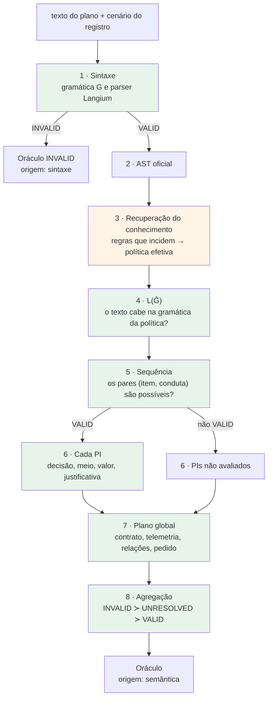

# Oráculo do SPC-CML — funcionamento e validação formal

Este documento explica como o SPC-CML decide se um plano produzido por um LLM é **válido**, **inválido** ou **indeterminado**, e por que essa decisão pode ser reproduzida sem pedir a opinião de outro LLM. Ele parte dos conceitos e liga cada um ao código que o implementa. No fim, um estudo de caso com a DSL de futebol percorre a avaliação inteira, com resultados obtidos em execução real.

Pressupõe familiaridade com programação e com LLMs, mas não com a arquitetura interna do SPC-CML.

> **Documentos relacionados.** O relatório [auditoria-oraculo.md](auditoria-oraculo.md) registra a inspeção do código: a ficha de cada validador, a classificação de cada afirmação por tipo de evidência, as lacunas encontradas e o script usado no estudo de caso. O [README raiz](../README.md) descreve o sistema inteiro; o Oráculo aparece no §10.

---

## Sumário

1. [O problema](#1-o-problema)
2. [O que é o Oráculo](#2-o-que-é-o-oráculo)
3. [Funcionamento de ponta a ponta](#3-funcionamento-de-ponta-a-ponta)
4. [Como funciona cada validação](#4-como-funciona-cada-validação)
5. [Os três vereditos e o que não é veredito](#5-os-três-vereditos-e-o-que-não-é-veredito)
6. [O que torna o Oráculo determinístico](#6-o-que-torna-o-oráculo-determinístico)
7. [Oráculo × LLM Judge](#7-oráculo--llm-judge)
8. [Estudo de caso: impedimento na DSL de futebol](#8-estudo-de-caso-impedimento-na-dsl-de-futebol)
9. [Limites](#9-limites)

---

## 1. O problema

O SPC-CML traduz um pedido em linguagem natural ("Impedimento marcado com o atacante 1.8 m atrás do último defensor. Procede?") num **plano**: um texto numa linguagem formal (a DSL) que um sistema poderia executar ou registrar. Quem escreve o plano é um LLM.

Avaliar esse plano é difícil por três motivos:

- **O texto não se repete.** O mesmo pedido pode render planos diferentes a cada geração, com outro identificador, outra justificativa, às vezes outra decisão. Não existe "o plano certo" contra o qual comparar o texto.
- **Forma correta não significa decisão permitida.** Um plano pode estar perfeitamente escrito na DSL e, mesmo assim, decidir algo que as regras do domínio proíbem naquele cenário.
- **Perguntar a outro LLM não resolve.** Um segundo modelo também é probabilístico, pode inventar regras e não oferece critério reprodutível.

O Oráculo responde a uma pergunta mais estreita e verificável: **este artefato obedece às regras formalizadas, dado o que se sabe sobre este cenário?**

## 2. O que é o Oráculo

### 2.1 Gerar não é verificar

Gerar o plano é tarefa do LLM, sob uma gramática que restringe o que ele consegue escrever. Verificar o plano é tarefa do Oráculo, que não gera nada e não chama LLM algum. Por isso o Oráculo **não precisa reconstruir o raciocínio do modelo** nem adivinhar o que ele "quis dizer". Julga o que foi escrito, com as entradas do cenário e as regras do domínio. Dois planos com o mesmo conteúdo formal recebem o mesmo veredito, venham de onde vierem.

### 2.2 As peças

| Conceito | O que é | No código |
|---|---|---|
| **DSL** | Linguagem formal do domínio, escrita em Langium. Tem duas metades: o *esquema de controle* (regras, limiares, vetos, contextos) e o *esquema de dados* (o universo fechado de decisões, meios e condutas que um plano pode conter) | [futebol.langium](../src/language/futebol.langium), modelo [futebol.fut](../src/examples/fut/futebol.fut) |
| **Gramática G** | BNF derivada da DSL e do modelo. Define que textos são planos bem formados | [futebol.bnf](../src/python_engine/grammar/futebol.bnf) (gerada) |
| **AST** | Árvore sintática oficial que o parser da DSL produz a partir do texto. É a representação **computável** do plano: campos tipados no lugar de texto | `DecisionCommand` em [ast.ts](../src/generated/ast.ts) |
| **Contexto do cenário** | O que se observou: a telemetria (leitura da partida), o sujeito, os contextos da competição e o pedido | registro do lote, reconstruído em [server.ts](../src/web/server.ts#L477) |
| **Conhecimento recuperado** | As regras que **incidem** neste cenário, obtidas comparando a telemetria com os limiares declarados na DSL | [`retrieveFutConstraints`](../src/knowledge/graphrag-fut.ts#L214) |
| **Política efetiva** | Para cada item (fármaco, produto, infração), as decisões, meios e valores que continuam admissíveis depois de aplicadas as regras que incidem. É a "lista do que se pode decidir agora" | `politicaEfetiva` em [`recuperarConhecimento`](../src/inference/recuperacao-conhecimento.ts#L188) |
| **Validadores determinísticos** | Funções que comparam o plano com a política, o contrato do artefato, a telemetria e o pedido, e devolvem um veredito com códigos e evidências | [validacao-sequencia.ts](../src/knowledge/validacao-sequencia.ts), [validacao-pi.ts](../src/knowledge/validacao-pi.ts), [validacao-global.ts](../src/knowledge/validacao-global.ts), [contrato.ts](../src/knowledge/contrato.ts) |
| **Veredito normativo** | O resultado do Oráculo: `VALID`, `INVALID` ou `UNRESOLVED`, com a camada que decidiu | [`oraculoDe`](../src/inference/avaliar-grafo.ts#L616) |

"Normativo" tem um sentido preciso aqui: o veredito diz se o plano está **conforme as normas que o SPC-CML formalizou**. Não diz se a decisão é a melhor possível, nem se as próprias normas estão certas.

### 2.3 Onde o Oráculo vive

O Oráculo é a parte determinística da avaliação de planos **já gerados**: a tela "Avaliar resultados", `POST /api/avaliar`. O ponto de entrada é [`avaliarPlano`](../src/inference/avaliar-grafo.ts#L806) e a sintaxe fica em [avaliar-sintaxe.ts](../src/inference/avaliar-sintaxe.ts). Os validadores semânticos são **os mesmos** que a geração multiagente usa para aceitar ou recusar o que o Planner e cada PI Agent propõem. O Oráculo não tem critério próprio.

## 3. Funcionamento de ponta a ponta



Verde: decisões por comparação estrutural ou numérica. Laranja: a recuperação contém uma etapa aproximada, o foco por embedding, discutida no §6. As etapas 4 a 8 formam a **validação semântica**.

| # | Etapa | Recebe | Verifica | Como | Produz | Efeito na próxima |
|---|---|---|---|---|---|---|
| 1 | Sintaxe | o texto | pertence à DSL? | duas peças precisam aceitar: G (Lark, via `/verify` sem política) e o parser Langium com ligação de referências ao modelo | `VALID`/`INVALID` + erros com posição | `INVALID` encerra: o Oráculo é `INVALID` e nada semântico roda |
| 2 | AST | a saída do parser | — | serialização oficial do Langium, com o literal de cada número | o AST, o único objeto que a semântica lê | a semântica não relê o texto (exceto em L(Ĝ)) |
| 3 | Recuperação | cenário do registro + modelo | que regras incidem? | comparação telemetria × limiares; foco; poda | política efetiva, contrato, regras, restrições | é a base de todo julgamento semântico |
| 4 | L(Ĝ) | texto + política | o texto cabe na gramática especializada pela política? | `/verify` com a política | etapa `VALID`/`INVALID`/não avaliada | registrada; as outras etapas rodam mesmo assim |
| 5 | Sequência | pares (item, conduta) do AST | cada par é possível? obrigatórias presentes? pedido coberto? | [`validarSequencia`](../src/knowledge/validacao-sequencia.ts#L250) | `VALID`/`INVALID`/`UNRESOLVED` | só com `VALID` a etapa 6 roda |
| 6 | PIs | cada cláusula + contexto **dela** | decisão, meio, valor e justificativa | [`decomporPIs`](../src/knowledge/decompositor.ts#L258) + [`validarPI`](../src/knowledge/validacao-pi.ts#L315) | idem | entra na agregação |
| 7 | Global | o plano inteiro | contrato do artefato, telemetria, dependências, relações, pedido | [`validarPlanoGlobal`](../src/knowledge/validacao-global.ts#L121) | idem | entra na agregação |
| 8 | Agregação | as etapas que rodaram | qual veredito prevalece | INVALID ≻ UNRESOLVED ≻ VALID | veredito semântico → Oráculo | — |

**Geração × avaliação.** Os validadores são os mesmos, mas o fluxo não é. Na geração, um pedido sem alvo ou um conhecimento com lacuna encerram **antes** de chamar o Planner; há retry, feedback e repoda. Na avaliação há uma única passada, e todas as etapas possíveis rodam para dar o diagnóstico completo. O pedido sem alvo aparece como `UNRESOLVED` na etapa global, e uma conduta obrigatória que ninguém pode cumprir é reclassificada como lacuna ([`reconciliarObrigatoriasIrrealizaveis`](../src/inference/avaliar-grafo.ts#L468)). As dependências entre PIs (`dependeDe`) não estão na DSL: vêm da sequência do Planner gravada no registro, quando ela existe. E a avaliação usa os validadores do modo multiagente qualquer que tenha sido o modo de geração. Detalhes na [auditoria, §2.3](auditoria-oraculo.md#23-geração--avaliação).

## 4. Como funciona cada validação

Os exemplos abaixo vêm, sempre que possível, do estudo de caso do §8 (cenário real `PT-2026-4124`, executado). Exemplos de outros domínios são citados pelo nome do teste que os contém.

### 4.1 Sintaxe

**Pergunta:** o texto é um plano da DSL?

```text
validarSintaxePlano(texto):
    se texto vazio            → INVALID [artefato_vazio]          (nenhuma peça chamada)
    parser ← Langium(modelo + texto)    # léxico, parse, ligação de referências
    g      ← /verify(texto, sem política)   # Lark sobre G completa
    se parser ou g lançar     → falha técnica (linha "não avaliada")
    erros  ← erros de g + erros do parser
    VALID com AST  se erros = ∅ e parser devolveu exatamente um artefato
    INVALID        caso contrário
```

As duas peças existem porque cada uma pega coisas que a outra deixa passar. A Langium liga referências (a infração citada existe no modelo?). G é mais estrita na forma: na DSL de futebol, `justificativa` é opcional para a Langium e obrigatória para G.

| Caso (executado, §8) | G | Parser | Veredito |
|---|---|---|---|
| plano A | ACEITO | ACEITO | `VALID` |
| plano A sem `justificativa` | RECUSADO (`UnexpectedToken` em `auditoria`) | ACEITO | `INVALID` |
| `marcacao Fora_De_Jogo` (infração inexistente) | RECUSADO | RECUSADO (`linking-error` em `MarkingStmt.infraction`) | `INVALID` |

Não há `UNRESOLVED` sintático: o texto pertence ou não à linguagem.

### 4.2 AST

O parser devolve o AST oficial e o avaliador o guarda **exatamente** como a semântica vai lê-lo. [`projetarAst`](../src/inference/avaliar-sintaxe.ts#L183) o converte no vocabulário do contrato (identificador, contexto, sujeito, sequência e cláusulas). O número de cada quantidade viaja também como o literal do texto (`"28.0"`), porque o retículo de valores compara strings. A semântica nunca relê o texto. Consequência testada: mudar quebras de linha ou o identificador não muda o veredito (§8.3).

### 4.3 Recuperação e política efetiva

**Pergunta:** neste cenário, o que cada item ainda admite?

```text
política inicial: todo item admite todas as decisões do esquema_dados
para cada regra declarada na DSL:
    se o parâmetro dela não está na telemetria → ignore a regra
    se a condição (parâmetro operador limiar) é verdadeira → aplique o efeito:
        veto (lance ou contexto)  → item fica só com as decisões de retirada
        regra de segurança        → item perde as decisões de sanção grave
foco: restringe aos itens e contextos ligados ao pedido (só retira, nunca acrescenta)
política efetiva = poda (ou o refinamento dela, no modo híbrido)
```

No futebol ([`retrieveFutConstraints`](../src/knowledge/graphrag-fut.ts#L214)), as decisões de retirada são `MANTER_JOGO`, `BLOQUEAR_DECISAO` e `ACIONAR_VAR`, e o minuto admissível de uma marcação é o da leitura (`valoresDaLeitura`). Essa etapa não emite veredito; ela produz o critério contra o qual as próximas julgam. Medida ausente faz a regra **não incidir**. Isso não é violação nem lacuna (§8.4).

### 4.4 L(Ĝ): a política como gramática

**Pergunta:** o texto cabe na gramática especializada pela política efetiva?

A partir da política, o motor reescreve G em Ĝ ([`especializar_por_item`](../src/python_engine/grammar_from_kg.py#L91)): uma produção por item, com as decisões, meios e valores daquele item, e o sujeito e os contextos do cenário fixados como literais. É a mesma gramática que, na geração, impede o modelo de escrever o que não pode.

| Caso (executado, §8) | Resultado |
|---|---|
| plano A (`MANTER_JOGO`) | `VALID` |
| plano B (`TIRO_LIVRE_INDIRETO`, vetado) | `INVALID`: `Unexpected token ... 'TIRO_LIVRE_INDIRETO'` |
| plano A com `minuto 30.0` (leitura: 28) | `INVALID`: `No terminal matches '3'` |
| política vazia (teste `med` "falta conhecimento necessario") | não avaliada: o motor nem gera Ĝ sem item |

### 4.5 Sequência

**Pergunta:** os pares (item, conduta) do plano são possíveis neste cenário?

Cada cláusula vira um par: o item e a *conduta* que o `esquema_dados` associa à decisão (por exemplo, `MANTER_JOGO` → `Manter_Jogo`).

```text
validarSequencia(pares):
    lacunas ← política vazia? mapa decisão→conduta vazio?
              conduta obrigatória que nenhum item realiza? item do pedido sem conduta?
    forma: ordens 1..n, dependências só para trás
    para cada par:
        item na política?                    senão item_fora_da_poda
        conduta existe?                      senão conduta_inexistente
        algum item a realiza?                senão conduta_nao_realizavel
        este item a realiza?                 senão item_conduta_incompativel (evidência: motivos da política)
        só por incremento, com regra sem medida (modo híbrido)? → lacuna telemetria_insuficiente
    unicidade por item; condutas obrigatórias presentes; itens citados no pedido tratados
    erros → INVALID;  senão lacunas → UNRESOLVED;  senão VALID
```

| Caso | Resultado |
|---|---|
| plano A (`Impedimento → Manter_Jogo`) | `VALID` |
| plano B (`Impedimento → Marcar_Tiro_Livre_Indireto`), com foco | `INVALID` `conduta_nao_realizavel`: nenhum item da política admite `TIRO_LIVRE_INDIRETO` |
| o mesmo plano B, sem foco | `INVALID` `item_conduta_incompativel`, com a evidência `vetado por lance Posicao_Legal_No_Passe` |
| política efetiva vazia (teste `med` "falta conhecimento necessario") | `UNRESOLVED`, faltando `itens na politica efetiva` |

### 4.6 PI (cada cláusula isolada)

**Pergunta:** a ação e a justificativa desta cláusula se sustentam no que *este* item sabe?

[`decomporPIs`](../src/knowledge/decompositor.ts#L258) monta, por cláusula, um contexto contendo só o que diz respeito ao par: decisões admissíveis da conduta, valores, fatos do item, telemetria pertinente e restrições. [`validarPI`](../src/knowledge/validacao-pi.ts#L315) julga a cláusula contra esse contexto:

```text
decisão realiza a conduta?                  senão decisao_nao_realiza_conduta
decisão admissível?                         senão decisao_inadmissivel
  (de incremento, tirada por bloqueio medido → telemetria_incompativel, com a medida como evidência)
meio admissível? valor no retículo da decisão?   senão meio_/valor_inadmissivel
justificativa:
  todo número aparece no contexto do PI?    senão justificativa_valor_inexistente
  "<parâmetro> <número>" = valor observado? senão justificativa_telemetria_divergente
  identificadores e ids de regra existem no contexto?   senão justificativa_referencia_inexistente
  conduta com justificativa_obrigatoria: cita alguma evidência do contexto?   senão justificativa_sem_suporte
                                          contexto sem evidência alguma → UNRESOLVED evidencia_insuficiente
```

| Caso | Resultado |
|---|---|
| plano A: "atacante 1.8 m atras do ultimo defensor no passe: sem posicao de impedimento, o jogo segue" | `VALID`: `1.8` está no pedido, e "atacante" e "defensor" são âncoras |
| plano A2: "distancia_ultimo_defensor 1.8: ..." (com foco) | `INVALID` `justificativa_referencia_inexistente`: o identificador não está no contexto deste PI (ver §8.4 e a [auditoria, L2](auditoria-oraculo.md#l2-com-o-foco-a-condição-que-sustenta-um-veto-ativo-some-do-contexto-do-pi-ic-d)) |
| plano A com `minuto 30.0` | `INVALID` `valor_inadmissivel`: `30.0 min esta fora do que o modelo declara ... 28.0 min` |
| regra sem medida ou contexto sem evidência (`test:pi-agent`, "caso 29") | `UNRESOLVED` |

A justificativa é conferida por **fatos verificáveis** (números, medidas, identificadores, âncoras), não por sentido.

### 4.7 Plano global

**Pergunta:** o plano inteiro é coerente? Dois PIs válidos isoladamente podem formar um plano inválido.

[`validarPlanoGlobal`](../src/knowledge/validacao-global.ts#L121) reaplica o contrato do artefato ([`verificarLido`](../src/knowledge/contrato.ts#L340): admissibilidade de cada cláusula, um item por cláusula, sujeito, contexto em foco, sequência ↔ cláusulas, escalonamento obrigatório) e acrescenta o que só o conjunto decide: incremento bloqueado pela telemetria, dependências, combinação de risco entre itens (`interacao` em `med`, `incompativel` em `agro`; no futebol, `agravante` nunca reprova), cobertura do pedido e medidas afirmadas nas justificativas contra a telemetria inteira. `regra_global` é só texto: gera um aviso e nunca reprova.

| Caso | Resultado |
|---|---|
| plano A | `VALID` |
| plano B | `INVALID` `decisao_inadmissivel`: `TIRO_LIVRE_INDIRETO nao e admissivel para Impedimento neste contexto (vetado por lance Posicao_Legal_No_Passe: ...)` |
| plano A, pedido sem o nome da infração | `UNRESOLVED` `pedido_global_indeterminado`: falta `item do pedido identificavel no conhecimento` |

### 4.8 Agregação e veredito

```text
etapas_avaliadas ← etapas cujo veredito ≠ NOT_EVALUATED
semântica ← INVALID     se alguma é INVALID
            UNRESOLVED  senão, se alguma é UNRESOLVED
            VALID       senão
oráculo   ← (INVALID, origem: sintaxe)   se sintaxe INVALID
            (semântica, origem: semântica) caso contrário
```

Uma violação comprovada decide, mesmo com outra etapa indeterminada. No §8, o plano B com pedido sem o nome da infração teve a etapa global `UNRESOLVED` e, ainda assim, saiu `INVALID` pelo `decisao_inadmissivel`.

## 5. Os três vereditos e o que não é veredito

| Veredito | Quer dizer | Garantia de forma |
|---|---|---|
| `VALID` | nenhum critério implementado reprova, dado o conhecimento usado | sem erro e sem dado faltante |
| `INVALID` | o conhecimento basta, e ao menos uma regra formalizada foi violada | ao menos um erro com código e mensagem |
| `UNRESOLVED` | algum critério não pôde ser aplicado porque faltou um dado | ao menos um dado faltante, nenhum erro |

Os construtores em [validacao.ts](../src/knowledge/validacao.ts) recusam `INVALID` sem erro e `UNRESOLVED` sem dado faltante.

**`UNRESOLVED` não é `INVALID`.** Ausência de evidência não é tratada como violação. Também não é `VALID`: o plano não foi aprovado. Os caminhos que levam a `UNRESOLVED` estão listados na [auditoria, §5.3](auditoria-oraculo.md#53-caminhos-reais-para-unresolved-no-avaliador).

Outros estados aparecem no resultado, mas **não são vereditos do Oráculo**:

| Estado | De quem | Significado |
|---|---|---|
| `NOT_EVALUATED` | camada semântica ou etapa | não rodou (sem AST, ou sem a pré-condição da etapa) |
| `naoAvaliado: true` | infraestrutura | falha técnica (motor, grafo, parser, defeito interno): **nenhum** veredito normativo é emitido |
| `NOT_CALLED`, `NO_RESPONSE` | LLM Judge | não foi chamado / não respondeu |
| `VALID`/`INVALID`/`UNRESOLVED` em `julgamentoLLM.status` | LLM Judge | opinião experimental, separada do Oráculo |
| `DISCORDANCIA_LLM` | comparação | o juiz disse outra coisa; o Oráculo fica como estava |

## 6. O que torna o Oráculo determinístico

### 6.1 O modelo conceitual

Como abstração (não é a assinatura de nenhuma função do código):

```text
resultado = validar(plano, AST, contexto, conhecimento, política, contrato)
```

Fixadas essas entradas, os validadores aplicam critérios definidos e produzem o mesmo resultado. Eles são funções síncronas, sem LLM, sem números aleatórios e sem consulta ao relógio na lógica (o relógio só mede duração). Isso foi verificado por inspeção do código e por execução repetida (§8.3). Não há prova formal.

### 6.2 Origem probabilística, critério determinístico

- Um LLM pode gerar planos diferentes para o mesmo pedido.
- Cada plano é avaliado de forma independente, pelos mesmos critérios.
- Planos diferentes podem receber o mesmo veredito (no §8, A e C, com decisões diferentes, saíram ambos `VALID`) ou vereditos distintos (B saiu `INVALID`).
- A origem probabilística do plano não torna probabilística a aplicação do critério. O critério não sabe nem precisa saber como o texto foi produzido.
- Ser determinístico não torna o critério **correto**. O Oráculo é tão bom quanto as regras e os dados formalizados. No §8, um cartão vermelho para um impedimento saiu `VALID`, porque a sanção declarada da infração não é um critério implementado.

### 6.3 O que precisa ser "o mesmo" para o veredito se repetir

| Entrada | Por que importa |
|---|---|
| texto do plano | é o artefato julgado |
| cenário do registro (telemetria, sujeito, contextos, pedido) | decide que regras incidem |
| sequência do Planner no registro | fornece as dependências, que a DSL não carrega |
| arquivo da DSL e BNF gerada | definem as regras e a gramática |
| **foco por embedding** (Neo4j, índice vetorial, modelo bge-m3, limiares `SPC_CML_FOCO_*`) | decide que itens e contextos entram na política; se o Neo4j cai, a recuperação segue com o grafo completo |
| `SPC_CML_RECUPERACAO` do processo | modo determinístico (padrão) ou híbrido |
| versões do código e do motor | os critérios estão no código |

A linha do foco é a mais delicada. O foco é **aproximado** (similaridade de vetores) e depende de serviço externo. No §8, o mesmo plano saiu `VALID` com o foco e `INVALID` sem ele, porque o conjunto de contextos aceitos mudou. O avaliador registra o aviso `foco_indisponivel` quando isso acontece, e `contexto_divergente` quando o Prompt Semântico reconstruído difere do gravado na geração. Isso não impede o veredito de mudar. Por isso, a afirmação correta é: **a aplicação dos critérios é determinística; a reprodutibilidade do veredito é condicionada a todas as entradas acima, inclusive o estado do conhecimento.**

### 6.4 O que o determinismo não significa

- Não significa que a geração seja determinística.
- Não significa que todas as situações reais do domínio estejam formalizadas.
- Não significa que `VALID` seja verdade no mundo real: significa conformidade com o que foi formalizado e recuperado.
- Não significa que o sistema inteiro seja determinístico: o foco, o RAG híbrido, a geração e o juiz não são.

## 7. Oráculo × LLM Judge

| | Oráculo | LLM Judge |
|---|---|---|
| Papel | referência **normativa** | avaliação **independente e experimental** |
| Como decide | critérios formais implementados | um LLM lê o plano, o pedido, a telemetria, o Prompt Semântico e as evidências ([julgamento.py](../src/python_engine/julgamento.py)) |
| Vê o outro? | não | não: o pedido ao juiz não contém sintaxe, AST, semântica nem Oráculo ([`pedidoDoJuiz`](../src/inference/avaliar-grafo.ts#L670)) |
| Quando roda | sempre: sem AST, decide pela sintaxe (`INVALID`); com AST, roda a semântica | sempre que há AST (texto fora da DSL só com `SPC_CML_AVALIAR_JULGAR_SINTAXE_INVALIDA=true`; artefato vazio nunca), **em paralelo** com a semântica |
| Falha | `naoAvaliado`, sem veredito | `NO_RESPONSE`; o Oráculo vale sozinho |

**Tratamento da discordância** ([`compararAvaliacoes`](../src/inference/avaliar-grafo.ts#L636)): se os dois dão o mesmo veredito, a linha é classificada pelo Oráculo (`VALIDO_PELO_ORACULO`, `INVALIDO_PELO_ORACULO`, `UNRESOLVIDO_PELO_ORACULO`). Qualquer outra combinação é `DISCORDANCIA_LLM`, e o veredito do Oráculo **fica como estava**: `UNRESOLVED` continua `UNRESOLVED`, mesmo que o juiz diga `VALID` ou `INVALID` (teste "caso 4 / teste D"). O juiz nunca corrige o Oráculo, e o Oráculo nunca corrige o juiz. A discordância é registrada e medida.

Discordância não prova que o Oráculo errou: o juiz pode estar inventando uma regra, ou o Oráculo pode não ter formalizada uma regra que o juiz percebeu. Concordância também não prova correção absoluta: os dois podem compartilhar a mesma lacuna do conhecimento. Quando o juiz responde `UNRESOLVED`, um diagnóstico opcional ([diagnostico-juiz.ts](../src/inference/diagnostico-juiz.ts)) explica a indeterminação **dele**. Também não é veredito e não altera nada.

## 8. Estudo de caso: impedimento na DSL de futebol

Tudo nesta seção vem do modelo real [futebol.fut](../src/examples/fut/futebol.fut) e de uma execução do **mesmo** `avaliarPlano` usado por `POST /api/avaliar`, em 2026-10-13, com Neo4j e o motor de futebol (`/verify`) no ar. O juiz LLM não foi chamado: o resultado registra `NO_RESPONSE`, por desenho. O script, o comando e a tabela completa estão na [auditoria, §8.2 e Anexo A](auditoria-oraculo.md#82-execução-do-oráculo-no-domínio-fut). Os planos A, B e C foram **escritos à mão para a demonstração**, não gerados pelo LLM. As variantes "sem a medida" e "pedido sem o nome" são **derivadas** do cenário real e identificadas como tais.

### 8.1 Preparação

**O cenário de origem** é a linha `PT-2026-4124` de [cenarios-400-fut.jsonl](../src/examples/fut/cenarios-400-fut.jsonl), sem edição:

```json
{"intencao": "Impedimento marcado com o atacante 1.8 m atrás do último defensor e três adversários à frente. Procede?",
 "partida": "PT-2026-4124",
 "telemetria": {"minuto_partida": 28, "acrescimo": 0, "cartoes_amarelos_jogador": 0, "distancia_ultimo_defensor": 1.8,
                "velocidade_bola": 0, "distancia_gol": 22, "jogadores_entre_bola_e_gol": 3, "tempo_revisao_var": 1,
                "placar_diferenca": -1, "faltas_acumuladas_time": 4, "distancia_bola": 1.2},
 "contextos": [], "infracoesEmUso": []}
```

**As regras pertinentes**, declaradas no modelo:

```text
infracao Impedimento { ... sancao NENHUM  reinicios [ TIRO_LIVRE_INDIRETO ] ... }          // futebol.fut:179

lance Impedimento_Ataque {                                                                  // futebol.fut:255
    gatilho: distancia_ultimo_defensor < 0.0 m -> "atacante a frente do penultimo adversario ..."
    recomenda Impedimento indicacao "posicao adiantada com interferencia no lance"
}

lance Posicao_Legal_No_Passe {                                                              // futebol.fut:268
    gatilho: distancia_ultimo_defensor >= 0.0 m -> "atacante na linha ou atras do penultimo adversario no momento do passe"
    veta Impedimento motivo "na linha ou atras do penultimo adversario nao ha posicao de impedimento"
}
```

O dicionário do modelo define `distancia_ultimo_defensor` como "distância com sinal do atacante ao penúltimo adversário no momento do passe; negativa = atacante adiantado, zero = na linha" ([futebol.fut:41](../src/examples/fut/futebol.fut#L41)). O limiar declarado é `0.0 m`.

**O esquema de dados** fecha o universo: treze decisões (de `ADVERTENCIA_VERBAL` a `BLOQUEAR_DECISAO`), oito reinícios, e uma conduta por decisão. Por exemplo, `conduta Manter_Jogo { decisao MANTER_JOGO justificativa_obrigatoria sim }` ([futebol.fut:461](../src/examples/fut/futebol.fut#L461)).

### 8.2 Caminho completo

**Passo 1. Comparação dos dados com as condições formais** ([`retrieveFutConstraints`](../src/knowledge/graphrag-fut.ts#L253)):

| Lance | Condição | Observado | Incide? | Efeito |
|---|---|---|---|---|
| `Impedimento_Ataque` | `distancia_ultimo_defensor < 0.0` | 1.8 | não | — |
| `Posicao_Legal_No_Passe` | `distancia_ultimo_defensor >= 0.0` | 1.8 | **sim** | **veta `Impedimento`** |
| `Jogador_Sem_Advertencia` | `cartoes_amarelos_jogador < 1.0` | 0 | sim | veta `Reincidencia_Amarelo` |
| `Mao_Curta_Distancia` | `distancia_bola < 1.0` | 1.2 | não | — |
| `Conduta_Violenta_Jogo` | `distancia_bola > 2.0` | 1.2 | não | — |
| `Revisao_VAR_Prolongada` | `tempo_revisao_var > 5.0` (gatilho e escalonamento) | 1 | não | nenhum escalonamento |

**Passo 2. Política de `Impedimento`.** Saída real:

```text
politica Impedimento: {"decisoes":["MANTER_JOGO","ACIONAR_VAR","BLOQUEAR_DECISAO"],
  "valores":[{"valor":"28.0","unidade":"min"}],"bloqueado":true,
  "motivos":["vetado por lance Posicao_Legal_No_Passe: na linha ou atras do penultimo adversario nao ha posicao de impedimento"]}
```

O veto reduz a infração às decisões de retirada ([`DECISOES_DE_RETIRADA`](../src/knowledge/graphrag-fut.ts#L111)), e o minuto admissível é o da leitura, `28.0 min` ([`valoresDaLeitura`](../src/knowledge/graphrag-fut.ts#L147)).

**Passo 3. Foco e política efetiva** ([`recuperarConhecimento`](../src/inference/recuperacao-conhecimento.ts#L188)). O pedido cita "Impedimento" pelo nome. O foco traz a infração e, pela aresta `recomenda`, o lance `Impedimento_Ataque`. Saída real:

```text
foco: {"infracoes":["Impedimento"],"lances":["Impedimento_Ataque"]}
politicaEfetiva: [{"item":"Impedimento","decisoes":["MANTER_JOGO","ACIONAR_VAR","BLOQUEAR_DECISAO"],"valores":[{"valor":"28.0","unidade":"min"}]}]
constantes: {"sujeito":"PT-2026-4124","contextos":["Impedimento_Ataque"]}
```

O veto do lance ativo fora do foco **continua valendo** ([`recomputarPoliticasFut`](../src/knowledge/graphrag-fut.ts#L721)). O contexto aceito no cabeçalho do plano passa a ser `Impedimento_Ataque`, o lance do foco, e não `Posicao_Legal_No_Passe` (§8.4).

**Passo 4. Os planos.** Três planos sintaticamente válidos para o mesmo cenário:

```text
A  arbitragem Arb_Demo_A para Impedimento_Ataque { esquema_referencia AssistenteArbitragem_v1 partida 'PT-2026-4124'
     sequencia [ Manter_Jogo ]
     marcacao Impedimento decisao MANTER_JOGO minuto 28.0 min reinicio SEM_PARALISACAO
       justificativa 'atacante 1.8 m atras do ultimo defensor no passe: sem posicao de impedimento, o jogo segue'
     auditoria 'demonstracao do oraculo' }

B  arbitragem Arb_Demo_B para Impedimento_Ataque { esquema_referencia AssistenteArbitragem_v1 partida 'PT-2026-4124'
     sequencia [ Marcar_Tiro_Livre_Indireto ]
     marcacao Impedimento decisao TIRO_LIVRE_INDIRETO minuto 28.0 min reinicio TIRO_LIVRE_INDIRETO
       justificativa 'impedimento do atacante marcado pelo assistente'
     auditoria 'demonstracao do oraculo' }

C  ... sequencia [ Acionar_Revisao_VAR ]
     marcacao Impedimento decisao ACIONAR_VAR minuto 28.0 min reinicio SEM_PARALISACAO
       justificativa 'atacante 1.8 m atras do ultimo defensor: revisao confirma a ausencia de impedimento' ...
```

(Na execução, cada plano estava numa única linha; as quebras acima são só de leitura.)

**Passo 5. Sintaxe e AST.** Os três passam pelas duas peças (`gramatica: ACEITO`, `parser: ACEITO`). AST real do plano A:

```json
{"$type":"DecisionCommand","name":"Arb_Demo_A","situation":{"$refText":"Impedimento_Ataque"},
 "schema":{"$refText":"AssistenteArbitragem_v1"},"match":"PT-2026-4124","sequence":[{"$refText":"Manter_Jogo"}],
 "markings":[{"$type":"MarkingStmt","infraction":{"$refText":"Impedimento"},"decision":"MANTER_JOGO",
   "minute":{"$type":"Quantity","value":28,"unit":"min","$literal":"28.0"},"restart":"SEM_PARALISACAO",
   "justification":"atacante 1.8 m atras do ultimo defensor no passe: sem posicao de impedimento, o jogo segue"}],
 "audit":"demonstracao do oraculo","alerts":[]}
```

**Passos 6 a 8. Cada validador.**

| Etapa | Plano A | Plano B | Onde divergem |
|---|---|---|---|
| Sintaxe | `VALID` | `VALID` | — |
| L(Ĝ) | `VALID` | `INVALID`: `Unexpected token Token('TIRO_LIVRE_INDIRETO', ...) at line 1, column 185` | Ĝ só deixa `Impedimento` com `MANTER_JOGO`, `ACIONAR_VAR` ou `BLOQUEAR_DECISAO` |
| Sequência | `VALID` | `INVALID` `conduta_nao_realizavel`: "nenhum item da politica efetiva admite TIRO_LIVRE_INDIRETO neste contexto" | o par `(Impedimento, Marcar_Tiro_Livre_Indireto)` não é realizável |
| PIs | `VALID` (aviso `pedido_indeterminado`) | não avaliado: "decomporPIs exige uma sequencia VALID" | — |
| Global | `VALID` (avisos `pedido_indeterminado`, `regras_globais_textuais`) | `INVALID` `decisao_inadmissivel`: "TIRO_LIVRE_INDIRETO nao e admissivel para Impedimento neste contexto (vetado por lance Posicao_Legal_No_Passe: ...). Admissiveis: MANTER_JOGO, ACIONAR_VAR, BLOQUEAR_DECISAO" | o contrato do artefato reaplica a política |
| **Oráculo** | **`VALID`** (origem: semântica) | **`INVALID`** (origem: semântica) | |

O plano C, com outra decisão admissível (`ACIONAR_VAR`), também saiu `VALID` em todas as etapas.

**Passo 9. Evidência que sustenta cada resultado.** O `INVALID` de B não é uma opinião: é a cadeia `distancia_ultimo_defensor = 1.8` → `1.8 >= 0.0` (gatilho de `Posicao_Legal_No_Passe`) → `veta Impedimento` → `Impedimento` admite só `MANTER_JOGO`, `ACIONAR_VAR`, `BLOQUEAR_DECISAO` → B decidiu `TIRO_LIVRE_INDIRETO`. Cada elo aparece na mensagem do erro ou na política impressa no passo 2. O `VALID` de A significa que nenhum critério implementado encontrou violação. Os avisos registram o que não pôde ser concluído: o pedido não nomeia uma decisão, e as `regra_global` são só texto.

**Contraste com outro cenário.** O mesmo tipo de plano B, aplicado ao cenário real `PT-2026-4123` (atacante 0,2 m **à frente**, `distancia_ultimo_defensor = -0.2`), saiu **`VALID`**: lá incide o gatilho de `Impedimento_Ataque`, não há veto, e `Impedimento` admite as 13 decisões. O critério é o mesmo; o que mudou foi a leitura.

### 8.3 Demonstração de determinismo

Na mesma execução:

- **Mesmo artefato, outro texto.** O plano A com outro identificador (`Arb_Outra_Geracao`) e quebras de linha produziu o mesmo veredito em todas as etapas. A semântica lê o AST, e o identificador não é critério.
- **Mesmas entradas, de novo.** A, avaliado três vezes, e B, avaliado duas, deram resultado lógico idêntico (comparação do `JSON` inteiro sem os tempos).
- **Outro processo.** Uma segunda execução completa do script reproduziu linha a linha as 167 linhas da anterior, inclusive as chamadas reais ao Neo4j e ao `/embed`.
- **Planos diferentes.** A (`MANTER_JOGO`) e C (`ACIONAR_VAR`) são planos diferentes com o mesmo veredito; B tem veredito diferente. Um LLM que gerasse qualquer um dos três, em qualquer ordem e com qualquer redação, teria cada um julgado pelo mesmo critério.

O que **não** se demonstra aqui: que a geração seja reprodutível, nem que todo lance de impedimento real esteja formalizado. O próprio gatilho de `Impedimento_Ataque` avisa que "a infração ainda depende da posição da bola, da metade do campo e de interferência no lance", fatores que a leitura não traz.

### 8.4 Quando falta informação, e quando o conhecimento muda

**Falta a medida que decide.** Removida `distancia_ultimo_defensor` da telemetria (variante derivada), nenhum dos dois lances de impedimento incide. `Impedimento` volta a admitir as 13 decisões, e o plano B saiu **`VALID`**. O resultado **não** é `UNRESOLVED`: no modo determinístico, regra sem medida simplesmente não incide ([graphrag-fut.ts:258](../src/knowledge/graphrag-fut.ts#L258)), e no modelo de futebol a exclusão por veto não tem critério de lacuna. A ausência de evidência não virou violação, o que é correto; mas também não virou indeterminação. Aqui, `VALID` quer dizer "nenhuma regra formalizada reprova", não "a marcação está fundamentada". A [auditoria, L4](auditoria-oraculo.md#l4-medida-ausente-não-gera-unresolved-no-modo-padrão-no-fut-nem-no-híbrido-ic) registra isso como lacuna de formalização.

**Falta o alvo do pedido.** Com o pedido reescrito sem a palavra "impedimento" (variante derivada: "O atacante estava 1.8 m atrás do último defensor quando o passe saiu. Procede a marcação do assistente?"):

| Plano | Etapas | Oráculo |
|---|---|---|
| A | L(Ĝ), sequência e PIs `VALID`; global `UNRESOLVED` `pedido_global_indeterminado` | **`UNRESOLVED`**, faltando `item do pedido identificavel no conhecimento` |
| B | L(Ĝ), sequência e global com erros; a global **também** acusa o pedido indeterminado | **`INVALID`**: a violação comprovada prevalece sobre a lacuna |

Este é o `UNRESOLVED` legítimo: o plano A não viola nada, mas o Oráculo não consegue concluir que ele responde ao pedido, e não inventa essa conclusão.

**O conhecimento muda: foco indisponível.** Com o Neo4j desligado de propósito, o foco falha e a recuperação segue com o grafo completo. Os contextos aceitos passam a ser os lances com gatilho ativo (`Posicao_Legal_No_Passe`, `Jogador_Sem_Advertencia`). O **mesmo** plano A, com cabeçalho `para Impedimento_Ataque`, saiu **`INVALID`** (`fora_da_gramatica_da_politica` e `contexto_fora_do_foco`), com o aviso `foco_indisponivel`. Ao contrário, um plano cuja justificativa cita `distancia_ultimo_defensor 1.8` foi recusado **com** foco (`justificativa_referencia_inexistente`: a condição do veto não chega ao contexto do PI quando o lance que veta está fora do foco) e aceito **sem** foco. Esses dois casos mostram, concretamente, por que o §6.3 inclui o foco entre as entradas que precisam ser as mesmas (ver a [auditoria, L1–L3](auditoria-oraculo.md#l1-o-veredito-depende-do-foco-por-embedding-ic-d)).

**O que o modelo declara mas o Oráculo não confere.** No cenário `PT-2026-4123`, `CARTAO_VERMELHO` para `Impedimento` saiu `VALID`, embora a infração declare `sancao NENHUM`; `reinicio PENALTI` também, embora ela declare `reinicios [ TIRO_LIVRE_INDIRETO ]`. O plano C afirma uma confirmação do VAR que a leitura não registra, contra uma `regra_global` do próprio modelo, e saiu `VALID`. Esses atributos são texto ou só alimentam o índice vetorial; não são critério ([auditoria, L5](auditoria-oraculo.md#l5-atributos-declarados-no-modelo-fut-que-nenhum-validador-confere-nf)).

### 8.5 Evidência reproduzível

| Resultado | Arquivos e funções executados | Testes que o sustentam |
|---|---|---|
| veto de `Posicao_Legal_No_Passe` em `Impedimento` | [`retrieveFutConstraints`](../src/knowledge/graphrag-fut.ts#L214), [`filtrarPorFocoFut`](../src/knowledge/graphrag-fut.ts#L642) | `test:foco-politica` "fut: o veto do Posicao_Legal_No_Passe ativo ao Impedimento sobrevive ao foco" (ok em 2026-10-13) |
| minuto = leitura | `valoresDaLeitura`, [`verificarClausulas`](../src/knowledge/contrato.ts#L176) | `test:contrato` "fut: o minuto da marcacao e o da leitura" |
| sintaxe pelas duas peças | [`validarSintaxePlano`](../src/inference/avaliar-sintaxe.ts#L361), `/verify` ([main.py](../src/python_engine/main.py#L554)) | `test:avaliar-oraculo` (domínio `med`) |
| B `INVALID` | `/verify` com política, [`validarSequencia`](../src/knowledge/validacao-sequencia.ts#L250), [`validarPlanoGlobal`](../src/knowledge/validacao-global.ts#L121) | `test:validacao-sequencia`, `test:validacao-global`, `test:avaliar-oraculo` "decisao fora da politica" (`med`) |
| A `UNRESOLVED` sem alvo | [`alvoDoPedido`](../src/knowledge/validacao-sequencia.ts#L159) via `validarPlanoGlobal` | `test:avaliar-oraculo` "pedido sem alvo" (`med`) |
| agregação e Oráculo | [`validarSemantica`](../src/inference/avaliar-grafo.ts#L516), [`oraculoDe`](../src/inference/avaliar-grafo.ts#L616) | `test:avaliar-oraculo` casos 1–4 |
| `agravante` não reprova no futebol | `relacionalDeRisco` | `test:validacao-global` "so a relacao de RISCO reprova combinacao: ... agravante (fut) nao" |

O avaliador não tem teste próprio no domínio de futebol: a cobertura do `avaliarPlano` é toda em `med`, e o caminho com foco real só foi exercitado pelo script desta demonstração. Para repetir: suba o Neo4j e o motor de futebol (`bash src/scripts/local/init.sh`), salve o script do [Anexo A da auditoria](auditoria-oraculo.md#9-anexo-a--script-da-demonstração-no-domínio-fut) e rode `npx tsx <arquivo>` na raiz do repositório, com `NEO4J_PASSWORD` no ambiente.

## 9. Limites

- O Oráculo verifica conformidade com as regras **formalizadas** e o conhecimento **recuperado**. Não verifica se as regras estão certas, se cobrem o domínio, nem se a decisão é correta no mundo real.
- A recuperação inclui um foco aproximado. O veredito é reprodutível dado o mesmo estado do conhecimento, não independentemente dele.
- No modo padrão, medida ausente faz a regra não incidir, em vez de produzir `UNRESOLVED`.
- A justificativa é conferida por fatos verificáveis, não por sentido.
- Texto livre do modelo (`regra_global`, mecanismos de relações, `isento`, `sancao`, `zona_penal`, reinícios por infração) não é critério.
- As dependências entre PIs vêm de um campo auxiliar do registro, não da DSL.

A lista completa, com evidência, consequência e o que seria preciso formalizar ou testar, está na [auditoria, §7](auditoria-oraculo.md#7-lacunas-e-divergências).
